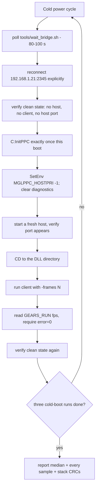

# Benchmarking the physical machine

This is the hardware-validated procedure for measuring the WarpOS PPC stack on
the physical A4000. Follow it top to bottom: every step below exists because
skipping it produced a wrong number, a stalled run, or a wedged machine.
Reference numbers and their conditions live in [performance.md](performance.md).

## 0. Verify the deployed stack first

Benchmarking is only meaningful against a verified deployment. Check CRC32 of
every artifact before the first run of a session (bridge `amiga_checksum`, one
file at a time, fully serialized). Example from the 2026-09-13 defect-fix
session (kept for illustration — **do not assume these are current**):

| File | CRC32 | Bytes |
|---|---|---:|
| `Work:ibdraw/minigl_ppc.dll` | `6C74A72D` | 305388 |
| `Work:ibdraw/mglhost` | `573F97A3` | 40624 |
| `LIBS:minigl.library` | `62343673` | 127252 |
| `LIBS:Picasso96/Radeon9200.chip` | `CEB838A6` | 77940 |
| `LIBS:Picasso96/Prometheus.card` | `18A453D6` | 7796 |
| `Work:ibdraw/precalc` | `1F3401F7` | 187136 |

For the current-source rebuild (2026-09-17 session): quiet DLL warpelf
`20575C7C`, converted DLL `E4A796C6`, profiled DLL `120F9C50`, host
`E9002FAB`. Rebuilds are not reproducible from committed binaries (the
external `radeon3d_emit.c` moves), so always rebuild and record the new CRCs.

Also:

- `mglhost` protection bits must read `00020000` (normal 68k). The Sonnet
  loader caches classification in the protection bits; a CRC match alone does
  not prove fast loading. Never "fix" bits on the DLL or PPC clients.
- `Work:ibdraw/chrome.ppm` present, and `data/chrome.ppm` relative to the
  client CWD (gears needs it even for the baseline workload).
- Driver pair installed as the active matched set, Workbench on the Radeon.

If you replaced `LIBS:minigl.library`, run `Avail Flush` before the first
client; AmigaOS otherwise keeps the old resident copy while disk CRCs match.

## 1. Boot protocol (once per boot)

1. **Cold power cycle.** A warm reboot does not reliably reset the Radeon;
   after any grey screen/guru/hang only a cold cycle counts.
2. Wait for the bridge (boot takes 80–100 s; poll, do not sleep a fixed time):
   ```
   /home/mirek/minigl_ppc/tools/wait_bridge.sh
   ```
3. Reconnect explicitly to the physical endpoint — localhost defaults fail:
   ```
   amiga_connect(host="192.168.1.21", port=2345)
   ```
4. Verify a clean process/port state: no leftover `mglhost`, no GL client, no
   `MiniGLPPC.R200.Host.1` port.
5. Run `C:InitPPC` **exactly once per boot**, before the first WarpOS/PPC
   client. Never run it again in the same boot; a wedged PPC client is
   recovered by a cold reboot, not another `InitPPC`.

## 2. Per-run protocol (every client run)

1. Set the benchmark environment explicitly:
   ```
   SetEnv MGLPPC_HOSTPRI -1
   ```
   Keep `MGLPPC_VERBOSE`, `MGLPPC_UPLOAD_TRACE`, `MGLPPC_CPEMIT`,
   `MGLPPC_IBSMOKE`, `MGLPPC_BATCH` and friends **unset** (a fresh boot is
   already unset; verify with `GetEnv`). Console writes and upload traces
   dominate frame time and poison the measurement; trace loggers must be
   compiled out of the binaries.
2. **Start a fresh 68k host before every client run:**
   ```
   Run >NIL: Execute Work:ibdraw/hostrun
   ```
   The host exits when the client closes its context (including aborted runs).
   Verify `MiniGLPPC.R200.Host.1` appears in the port list before launching.
   `hostrun` is idempotent from DOS's point of view: if an old host is alive,
   the new one exits and the client talks to the old one — always check.
3. **Run the client with the DLL directory as the current directory** — the
   Hyperion loader resolves `minigl_ppc.dll` from the client's CWD:
   ```
   CD Work:ibdraw
   ```
4. Gears needs `data/chrome.ppm` relative to the CWD:
   ```
   CD Work:ibdraw
   makedir data
   copy chrome.ppm data/chrome.ppm
   ```
   Missing-file symptom: `milestone_gears_stats_library: can't find texture
   data/chrome.ppm`, and the aborted run consumes the host.

The protocol as a flow (each performance claim repeats this whole cycle
three times and reports the median plus every sample):



## 3. Benchmark commands

Fullscreen reference workload (precalc gears):

```
CD Work:ibdraw
precalc -frames 600 -width 640 -height 480 -depth 16 -buffers 3 -nosync -nofps >Work:ibdraw/baselineN.log
Type Work:ibdraw/baselineN.log
```

Windowed CP-emitter workload (needs a CP-capable stack and `MGLPPC_CPEMIT 1`;
see [reference/CP_EMITTER.md](reference/CP_EMITTER.md)):

```
Execute Work:ibdraw/benchrun
```

Read the `GEARS_RUN frames=... fps=...` summary line. It is printed by the
`-frames N` auto-exit path and is independent of console rendering cost.
`error=0` is mandatory; discard any run with a GL error or wedged teardown and
re-run after recovery.

Do not use 16-bit *windowed* presentation as a throughput target (known-slow,
~3 FPS). Fullscreen 16-bit with 3 buffers is the reference; 1-buffer
fullscreen shows scanout banding (visual only).

## 4. Run hygiene

- Serialize **all** Amiga filesystem/DOS operations. Concurrent bridge requests
  collide through shared temp files and produce missing or misleading results.
- Amiga-side deployment names at most 16 characters; verify destination CRC32
  after every transfer (truncation aliases can silently overwrite another
  build; equal size ≠ equal build).
- Change one variable at a time. The comparison set is: same boot protocol,
  same stack CRCs, same environment, same command line.
- Between isolation runs: let the client exit through its normal quit path.
  Never `Break` a fullscreen GL client and immediately launch another —
  in-flight CP work can wedge the machine. After any interruption run a small
  bootstrap/service probe before the next heavy client.
- After each run confirm clean state (`Status`, no host port) before the next.
- A successful cross-build is not deployment validation. Record: commit +
  dirty state, artifact CRCs, backend/driver pair, CPU and board, mode/depth,
  buffers, sync state, cold/warm boot state, and the exact commands run.
- Three independent cold-boot runs, median + every sample, for performance
  claims.

## 5. Recovery

- Wedged PPC client (ignores break signals, no output): operator cold power
  cycle, then repeat section 1. Do not `Break` + relaunch.
- Degraded windowed presentation after a crash while simpler tests pass: the
  Radeon was not reset — only a cold cycle fixes it.
- Bridge unreachable after boot: re-check `Status` via a fresh connection; the
  bridge must be running; use `wait_bridge.sh`, not fixed sleeps.

## 6. Profiling builds and attribution

When a number is surprising, attribute it before touching code. Two opt-in
profiler variants (diagnostics only — never production):

- **PPC frontend**: `MGLPPC_PROFILE=1 make -f Makefile.dll.r200.gcc
  OBJDIR=obj/dll-r200-prof WARPELF=bin/minigl_ppc_r200_prof.warpelf`.
  On context destroy it writes buckets (control, texture, barrier, publish,
  yield) to `DH2:mglprof/dll-profile.log`.
- **68k host**: `MGLPPC_PROFILE=1 R200_HOST=bin/minigl_ppc_host_prof
  make -f Makefile.dll.r200.gcc host`; at shutdown it prints session
  attribution (control/barrier/mailbox/ring ticks, uploads, `HOST_SUBIMAGE`
  handler/preflight/native/bridge breakdown) to its redirected stdout.

Run them from **dedicated directories** — the Hyperion loader resolves
`minigl_ppc.dll` from the client's CWD, so a directory holding the profiling
DLL plus a fresh host from that same directory replaces the quiet stack for
the measurement. Copy the client and `data/` there too. Never benchmark
profile builds against quiet numbers: both profilers change timing (~5%).

Session corrections worth remembering:

- Reading big logs: `Type` on a redirected host log can wedge the bridge's 30 s
  window. `Copy` the log to a new name first, then read or pull it. Pull runs
  at ~19 KB/s — a 900 KiB PPM will time out; verify screenshots by reading
  their 20-byte header instead.
- Raw file reads at offset 0 are the fast path for headers and short tails;
  keep grep-style filtering on the host side after pulling.
- A mistyped command like `Start:` becomes a disk requester; the machine waits
  on "Please insert volume …" and everything else stalls. After any aborted
  script, screenshot the screen and dismiss requesters before continuing.
- Client-side timings use `DateStamp` (50 Hz). A 10-iteration loop carries
  ±2 ms/iteration of noise — use ≥20 iterations before quoting sub-5 ms
  numbers.
- `SetEnv NAME ""` leaves an empty variable that `GetVar` treats as
  unset-length-zero; effectively off, but prefer `GetEnv` to confirm a
  diagnostic is truly off before a quiet run.

## 7. Deploying replacement binaries

1. Build locally; record CRC32 of the `.warpelf`.
2. Push it (serialized), CRC-verify the transfer.
3. Convert on target: `DH2:wosbuild/Elf2Exe2 <name>.elf <name>` — the
   converted artifact has a **different** CRC; record it.
4. Back up the active file (`copy X X.pre-<tag>`), then copy the new binary
   over it and verify the ACTIVE path's CRC — never just the staging path.
5. 68k host only: after replacing `mglhost`, reapply the Sonnet classification
   bits — `(bits & ~0x00030000) | 0x00020000` — and read them back.
6. After replacing `LIBS:minigl.library`: `Avail Flush`, then re-validate with
   a small client before heavy work.

Never mix DLL and host from different builds: the result is a deterministic
~7.8 FPS with `presents=0`.

### 7.1 Do not benchmark a dirty worktree

Record the artifact CRC32 *and* its build provenance. Only CRC identifies a
build, and a CRC recorded on a previous session says nothing about the binary
in your hand today.

`backend_r200/library/r200_*.c` and
`classic_68k/dev/MiniGL_Library_Source_Code/library/r200_*.c` are separate
files that share names. The 68k `minigl.library` is compiled from the classic
tree; the PPC DLL is compiled from `backend_r200/library/` (via
`r200_unity.c` -> `r200_frontend.o`). Confirm which tree your edit reached
before concluding anything from a run.

When a number collapses unexpectedly, rebuild the stack from a pristine
worktree and re-run the **identical** workload before optimising anything:

```sh
git worktree add --detach /tmp/opencode/clean-main HEAD
```

If the `dispatches`, `dwords` and `presents` counters are unchanged between
the two builds while the frame time moves, the delta is CPU-side overhead
rather than rendering, and a hot-path debug logger or an unconditional layout
change is the first thing to look for. A bounded counter does not make
per-`glClear` or per-batch file I/O safe. See the measured 2.55x case in
[performance.md](performance.md) section 2.0.

## 8. Reference scripts on the Amiga (`Work:ibdraw/`)

| Script | Purpose |
|---|---|
| `hostrun` | Start the 68k host (`mglhost >host.log`) |
| `benchrun` | Windowed 800x600x32 CP gears run into `run.log` |
| `precalc` | The fixed fullscreen reference client binary |
| `gears` | The non-precalc variant used by `benchrun` |
| `defprobe` | Isolated defect/perf probe (`examples/r200_defect_probe.c`) |
| `texupdate.new` | Pixel-verified texture acceptance client |

Logs (`*-client.log`, `*-host.log`, `baseline*.log`, `defprobe*.log`,
`run.log`) are append-evidence; do not delete them when re-running — write new
files instead. Profiler-only artifacts live under
`Work:ibdraw/profdir{,/pfrun}` and are never production deploys.
