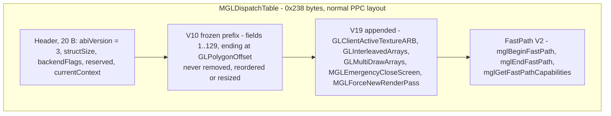

# Dispatch ABI (`MGLDispatchTable`)

The dispatch table is the contract between every MiniGL client and the DLL. It
is **positional**: clients and DLLs are compiled against the same struct and
agree on byte offsets, not on symbol names. This document is normative for the
PPC tree; the classic 68k library has its own, independently versioned table
(do not confuse the two).

## 1. Version constants

| Constant | Value | Where |
|---|---|---|
| `MINIGL_VERSION` | 19 | `include/libraries/minigl.h` |
| `MINIGL_MIN_VERSION` | 10 | `include/libraries/minigl.h` |
| `MINIGL_DISPATCH_ABI_VERSION` | 3 | `include/libraries/minigl_dispatch.h` |
| `MINIGL_BACKEND_FLAG_STUB` | `1<<0` | ditto |
| `MINIGL_BACKEND_FLAG_CLASSIC` | `1<<1` | ditto |
| `MINIGL_BACKEND_FLAG_PISTORM3D` | `1<<2` | ditto |
| `MINIGL_BACKEND_FLAG_PPC` | `1<<3` | ditto |
| `MINIGL_BACKEND_FLAG_R200` | `= PPC` | ditto |
| `MINIGL_PPC_DLLNAME` | `"minigl_ppc.dll"` | client loads by this name |
| `MINIGL_PPC_PORTNAME` | `"MiniGLPPC.DLL"` | Hyperion process port |
| `sizeof(MGLDispatchTable)` | `0x238` (568 bytes) | compile-time checked in the R200 initializer |

The ABI version and the API version move independently: ABI stayed `3` when the
API level went 10 → 19 because the V10 layout is preserved as a prefix.

**Regression note (fixed 2026-10-20).** The three FastPath V2 slots were
missing from the committed tree, which built a `0x22c` table. They existed
only in the parked WIP snapshot `cae45a0`. A client compiled against the
`0x238` header, such as the A1b Quake build `glqfinal`, reads its FastPath
pointers past the end of such a DLL's table. It dies with a PowerPC Data
Storage exception at DAR `0x10`, at the same code offset on every load. If a
FastPath client shows that signature, check the DLL's table size before
anything else.

## 2. Table layout

```
struct MGLDispatchTable {
    ULONG abiVersion;              /* must equal 3                        */
    ULONG structSize;              /* sizeof(MGLDispatchTable) = 0x238    */
    ULONG backendFlags;            /* bitmask, see above; R200 sets PPC   */
    ULONG reserved;                /* 0                                  */
    GLcontext *currentContext;     /* -> the DLL-owned global context     */
    ... function pointers ...      /* fields 1..137 below                 */
};
```

- **Normal PPC layout, no packing.** PPC layout is 4-byte pointers and 4-byte
  ULONGs; both sides of the ABI are PPC. Do not add `#pragma pack` here.
- Field order is append-only. The V10 frozen boundary is `GLPolygonOffset`
  (field 129). New entries go strictly after it.
- The `currentContext` pointer is what lets wrappers be context-free: it is
  re-read on every call (`MGLD_CTX = (*MiniGLDispatch->currentContext)`), so a
  context create/destroy is immediately visible to subsequent calls.

Layout of the table (offsets grow downwards; field *i* is at `20 + (i-1)*4`):



### 2.1 Frozen V10 prefix (fields 1–129, in order)

```
GLActiveTextureARB GLAlphaFunc GLArrayElement GLBegin GLBindTexture GLBlendFunc
GLClear GLClearColor GLClearDepth GLColor3fv GLColor3ubv GLColor4f GLColor4fv
GLColor4ub GLColor4ubv GLColorMask GLColorPointer GLColorTable GLCullFace
GLDeleteTextures GLDepthFunc GLDepthMask GLDepthRange GLDisableClientState
GLDrawArrays GLDrawBuffer GLDrawElements GLEnableClientState GLEnd GLFinish
GLFlush GLFogf GLFogfv GLFrontFace GLFrustum GLGenTextures GLGetBooleanv
GLGetError GLGetFloatv GLGetIntegerv GLGetString GLHint GLIsEnabled
GLLoadIdentity GLLoadMatrixd GLLoadMatrixf GLLockArrays GLMatrixMode
GLMultMatrixd GLMultMatrixf GLMultiTexCoord2fARB GLMultiTexCoord2fvARB
GLNormal3f GLOrtho GLPixelStorei GLPointSize GLPolygonMode GLPopMatrix
GLPushMatrix GLReadPixels GLRotated GLRotatef GLRotatefEXT GLRotatefEXTs
GLScaled GLScalef GLScissor GLShadeModel GLTexCoord2f GLTexCoord2fv
GLTexCoord4f GLTexCoord4fv GLTexCoordPointer GLTexEnvi GLTexGeni GLTexImage2D
GLTexParameteri GLTexSubImage2D GLTranslated GLTranslatef GLULookAt
GLUPerspective GLUnlockArrays GLVertex2fv GLVertex3fv GLVertex4f GLVertex4fv
GLVertexPointer GLViewport
MGLClearPointer MGLCreateContext MGLCreateContextFromID MGLDeleteContext
MGLDrawMultitexBuffer MGLEnableSync MGLExit MGLGetInputWindowHandle
MGLGetWindowHandle MGLIdleFunc MGLKeyFunc MGLLockBack MGLLockDisplay
MGLLockMode MGLMainLoop MGLMinTriArea MGLMouseFunc MGLPrintMatrix
MGLPrintMatrixStack MGLResizeContext MGLSetPointer MGLSetState MGLSetZOffset
MGLSpecialFunc MGLSwitchDisplay MGLTexMemStat MGLUnlockDisplay MGLWriteShotPPM
mglChooseGuardBand mglChooseMtexBufferSize mglChooseNumberOfBuffers
mglChoosePixelDepth mglChooseTextureBufferSize mglChooseVertexBufferSize
mglChooseWindowMode mglGetSupportedScreenModes mglProhibitAlphaFallback
mglProhibitMipMapping mglProposeCloseDesktop GLPolygonOffset
```

### 2.2 V19 appended entries (fields 130–137)

| # | Field | Semantics in this tree |
|---|---|---|
| 130 | `GLClientActiveTextureARB` | `Lib_glClientActiveTextureARB`: selects the unit-0/unit-1 texture-coordinate array |
| 131 | `GLInterleavedArrays` | mglQ3/R200 implementation |
| 132 | `GLMultiDrawArrays` | loops `GLDrawArrays` internally |
| 133 | `MGLEmergencyCloseScreen` | conservative no-op |
| 134 | `MGLForceNewRenderPass` | conservative no-op |
| 135 | `mglBeginFastPath` | FastPath V2 direct vertex-buffer begin (see §4) |
| 136 | `mglEndFastPath` | FastPath V2 end |
| 137 | `mglGetFastPathCapabilities` | capability bits (0 when unsupported) |

`FromWindow`/`CreateContextFromWindow` are intentionally **not** part of this
API and must not be added.

### 2.3 Silent Hill private tail

The historical Silent Hill reference DLL has a private three-entry extension in
the same tail region (`0x218..0x220` in the ABI-3 table). Static analysis of
`SilentHill.elf` confirmed it accesses only the frozen prefix and accepts any
table of at least `0x224` bytes, so it is compatible with the current `0x238`
table. Do not claim compatibility for any other client that calls the private
extension; those slots are not part of V19.

## 3. Client-side wrappers

`include/libraries/minigl_dispatch.h` provides the wrappers under
`#ifndef MINIGL_LIBRARY_BUILD`. A dispatch client:

```c
#include <mgl/gl.h>                       /* pulls in the declarations */
#include <libraries/minigl_dispatch.h>
...
MiniGLOpen();
glClear(GL_COLOR_BUFFER_BIT);             /* inline wrapper              */
MiniGLClose();
```

Rules encoded in the header:

- `extern const MGLDispatchTable *MiniGLDispatch;` is the only global.
- Every `gl*`/`mgl*`/`glu*` name is a static-inline function that injects
  `MGLD_CTX` (the current context) and forwards to the table slot.
- `glEnable`/`glDisable` fold into `MGLSetState(ctx, cap, GL_TRUE/GL_FALSE)`.
- Some narrow API calls adapt to a wider slot (`glColor3f`, `glColor3ub`,
  `glVertex2f`, `glVertex3f`, `glTexEnv*`, `glTexParameter*`).
- `mglCreateContext`/`mglCreateContextFromID` update `*currentContext` on
  success; `mglDeleteContext` clears it before deleting.
- `gluLookAt`/`gluPerspective` guard against a null context.
- `mglChoosePixelDepth` coerces 32 → 24 only under the PiStorm3D flag (not the
  R200 path).
- `GLTexImage2D`/`GLTexSubImage2D` are the only entries with more than eight
  parameters. vbcc/WarpOS clients use the PowerOpen ABI, which disagrees with
  the GCC DLL's SysV ABI for arguments 9+. The header therefore exposes block
  helpers (`MGLTexImage2DArgs`/`MGLTexSubImage2DArgs`); the DLL exports
  `MGLTexImage2DBlock`/`MGLTexSubImage2DBlock` and clients resolve them with
  `dllGetProcAddress()`, falling back to the raw table slot. The DLL bridges
  PowerOpen callers to SysV with `backend_r200/client/r200_poweropen_bridge.s`.

Client validation happens in `MiniGLOpen` and must never be weakened:

```c
dispatch->abiVersion  != MINIGL_DISPATCH_ABI_VERSION        -> fail
dispatch->structSize  <  sizeof(MGLDispatchTable)           -> fail
dispatch->currentContext == NULL                            -> fail
```

Consequences:

- A V19 client **rejects** a V10 DLL (`structSize` too small).
- A V10 client **accepts** the V19 DLL because the prefix it reads is unchanged
  and larger tables are tolerated.

## 4. FastPath V2 (`include/libraries/minigl_fastpath.h`)

FastPath lets a client fill a vertex buffer directly while the library supplies
current attribute state, avoiding one call per attribute. It is a public V19
feature, separate from the Silent Hill private tail.

- `MGL_FASTPATH_VERSION` = 2; `MGL_FASTPATH_OFFSET_NONE` = `0xffffffff`.
- Attribute bits: `POSITION`, `COLOR`, `TEXCOORD0`, `TEXCOORD1`, `TEXCOORD_Q`,
  `NORMAL_INDEX`, `NORMAL`; reserved: `FOG`, `POINT_SIZE`.
- `MGL_FASTPATH_CAPABILITIES_V2` is the OR of the implemented V2 bits.
- `MGLFastPath` carries the requested/supported attributes, primitive type,
  buffer base/stride/count/capacity and per-attribute offsets for client-side
  interleaved arrays. When a direct buffer is not used, the library supplies
  live `x/y/z/w`, `r/g/b/a`, `u0/v0`, `u1/v1`, `q` and `normalIndex` pointers.
- SDK inlines (`mglFastPathHasRoom`, `mglFastPathRefreshPointers`,
  `mglFastPathColor4f/3f`, `mglFastPathTexCoord2f`, `mglFastPathVertex3f`,
  `mglAdvanceFastVertex`, …) perform no library calls in the inner loop;
  `mglAdvanceFastVertex` copies current attributes and bumps the count.
- The frontend implements the entry points; an unsupported backend returns
  `GL_FALSE` from `mglBeginFastPath` (the mglQ3 DLL and the stub do).

## 5. Table initializers that must stay synchronized

`MGLDispatchTable` has four independent positional initializers plus one
generated table. Any API change must update **all** of them in the same change:

| File | Used by |
|---|---|
| `include/libraries/minigl_dispatch.h` | struct + wrappers (source of truth) |
| `ppc_dll/minigl_ppc_dispatch.c` | real mglQ3 DLL |
| `ppc_dll/minigl_ppc_dispatch_stub.c` | diagnostic stub DLL |
| `ppc_dll/minigl_ppc_dispatch_r200.c` + `backend_r200/generated/dispatch_table_abi3.c` | direct-R200 DLL |
| `classic_68k/.../library/dispatch_table_{classic,stub,pistorm3d,r200}.c` | classic 68k library backends |
| `classic_68k/dev/include/libraries/minigl_dispatch.h` | packaged classic copy |

The classic tree additionally owns `dev/include/` and `dev/lib/` release
copies. `AGENTS.md` lists the full synchronization requirement; treat a missed
initializer as a build-breaking defect.

### 5.1 R200 generation

```
tools/generate_dispatch_r200.py \
    include/libraries/minigl_dispatch.h \
    backend_r200/generated/r200_symbols.txt \
    backend_r200/generated/dispatch_table_abi3.c
```

- `r200_symbols.txt` is `nm --defined-only` filtered to `T` symbols matching
  `Lib_*` from `r200_frontend.o`.
- The generator parses the struct field order from the header, maps each field
  to `Lib_<name>` (with GL→`Lib_gl*`, MGL→`Lib_mgl*`, etc.), and emits a
  context-dropping thunk per field.
- Explicit special cases: `MGLSetState` → `Lib_glEnable`/`Lib_glDisable`;
  `GLClientActiveTextureARB` maps to `Lib_glClientActiveTextureARB`;
  `MGLResizeContext`, `MGLForceNewRenderPass` are no-ops; `GLMultiDrawArrays` loops `Lib_glDrawArrays`; `mglBeginFastPath` and
  friends bind when present.
- Missing implementations become `R200Unsupported_*` thunks that call
  `LibUnsupported()` and set `GL_INVALID_OPERATION` — a missing symbol can
  never leave a NULL slot.
- `GLTexImage2D`/`GLTexSubImage2D` are overridable and wired to the
  PowerOpen/SysV trampolines (`R200PowerTexImage2D/SubImage2D`).
- The emitted table header is
  `{ MINIGL_DISPATCH_ABI_VERSION, sizeof, R200 flag, 0, &mini_CurrentContext }`
  and the file is marked "generated; do not edit".

`ppc_dll/minigl_ppc_dispatch_r200.c` adds a compile-time size assertion
(`sizeof(MGLDispatchTable) == 0x238`) and the `R200ABI3*` legacy-context shims.

## 6. Changing the ABI safely

1. Add the field at the **end** of the struct, after the FastPath block if you
   are adding a new group; never insert above `GLPolygonOffset`.
2. Add the wrapper in `minigl_dispatch.h` (with the correct special-case
   handling) and any public header/enum it needs.
3. Bind it in the real mglQ3 initializer, the stub initializer and the R200
   frontend (implement `Lib_*` or provide an explicit stub).
4. Regenerate the R200 table; do not edit the generated file.
5. Update the classic initializers and packaged header if the classic tree
   consumes the same ABI revision (coordinate with its `AGENTS.md`).
6. Bump nothing in the ABI version for a pure append; bump only on a
   reordering/removal, which is forbidden anyway.
7. Update this document and `docs/README.md` in the same commit.

## 7. Known compatibility limits

- A backend may leave a slot as an explicit no-op (documented in
  [client-guide.md](client-guide.md#intentional-no-ops-and-limits)); clients must not
  assume a call has an effect just because the slot exists.
- `mglBeginFastPath` returning `GL_FALSE` is a valid answer; check it.
- The ABI-3 table is not portable to the classic shared library (different
  library model, different ABI version) and vice versa.
