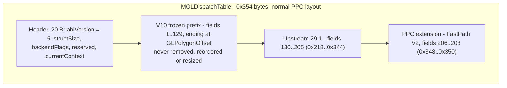

# Dispatch ABI (`MGLDispatchTable`)

The dispatch table is the contract between every MiniGL client and the DLL. It
is **positional**: clients and DLLs are compiled against the same struct and
agree on byte offsets, not on symbol names. This document is normative for the
PPC tree; the classic 68k library has its own, independently versioned table
(do not confuse the two).

## 1. Version constants

| Constant | Value | Where |
|---|---|---|
| `MINIGL_VERSION` | 29 | `include/libraries/minigl.h` (overridable on the compile line, as upstream) |
| `MINIGL_MIN_VERSION` | 29 | `include/libraries/minigl.h` |
| `MINIGL_DISPATCH_ABI_VERSION` | 5 | `include/libraries/minigl_dispatch.h` |
| `MINIGL_BACKEND_FLAG_STUB` | `1<<0` | ditto |
| `MINIGL_BACKEND_FLAG_CLASSIC` | `1<<1` | ditto |
| `MINIGL_BACKEND_FLAG_PISTORM3D` | `1<<2` | ditto |
| `MINIGL_BACKEND_FLAG_PPC` | `1<<3` | ditto |
| `MINIGL_BACKEND_FLAG_R200` | `= PPC` | ditto |
| `MINIGL_PPC_DLLNAME` | `"minigl_ppc.dll"` | client loads by this name |
| `MINIGL_PPC_PORTNAME` | `"MiniGLPPC.DLL"` | Hyperion process port |
| `sizeof(MGLDispatchTable)` | `0x354` (852 bytes) | compile-time checked in all three DLL initializers |

**ABI 5 is upstream minigl.library 29.x's ABI.** Slots 1..205 match the
upstream 29.1 header (`libraryroot/include/libraries/minigl_dispatch.h`,
upstream commit `d950a3a`) field for field, so a client built against either
header reaches the same entry point at the same offset. Upstream moved 3 -> 4
when the `mgl/gl.h` tokens took OpenGL's own values (a client built on the old
auto-numbered header passes different integers for the same names, which
`structSize` cannot catch), and 4 -> 5 as its declared 29.0 release boundary.
`MiniGLOpen` tests the version for **equality**, so every ABI-3 (V19) client is
refused by this DLL and must be rebuilt against the current headers; an ABI-3
DLL equally refuses an ABI-5 client.

`tools/check_dispatch_layout.py` compares the header with the vendored upstream
snapshot `tools/reference/minigl_dispatch_v29_1.txt` slot by slot (name and
parameter types) and checks that only the FastPath trio follows slot 205. The
R200 build runs it before generating its table; run it by hand after any
dispatch change:

```
python3 tools/check_dispatch_layout.py include/libraries/minigl_dispatch.h
```

**FastPath regression note (fixed 2026-10-20, offsets now ABI 5).** The three
FastPath V2 slots were once missing from the committed tree, which built a
table without them; a FastPath client compiled against a header that has them
then reads its FastPath pointers past the end of the DLL's table and dies with
a PowerPC Data Storage exception at DAR `0x10`, at the same code offset on
every load. If a FastPath client shows that signature, check the DLL's table
size (`0x354`) before anything else.

## 2. Table layout

```
struct MGLDispatchTable {
    ULONG abiVersion;              /* must equal 5                        */
    ULONG structSize;              /* sizeof(MGLDispatchTable) = 0x354    */
    ULONG backendFlags;            /* bitmask, see above; R200 sets PPC   */
    ULONG reserved;                /* 0                                  */
    GLcontext *currentContext;     /* -> the DLL-owned global context     */
    ... function pointers ...      /* fields 1..208 below                 */
};
```

- **Normal PPC layout, no packing.** PPC layout is 4-byte pointers and 4-byte
  ULONGs; both sides of the ABI are PPC. Do not add `#pragma pack` here.
- Field order is append-only. The V10 frozen boundary is `GLPolygonOffset`
  (field 129). Fields 130..205 follow upstream exactly; new upstream slots go
  after 205 and **before** the FastPath block, which then moves.
- The `currentContext` pointer is what lets wrappers be context-free: it is
  re-read on every call (`MGLD_CTX = (*MiniGLDispatch->currentContext)`), so a
  context create/destroy is immediately visible to subsequent calls.
- The DLL's own table is writable: display-list compilation swaps slots in it
  (section 4.2). Clients see it through a `const` pointer.

Layout of the table (offsets grow downwards; field *i* is at `20 + (i-1)*4`):



One prefix field changed type with ABI 5: `MGLResizeContext` (field 109)
returns `GLboolean`, as upstream; every PPC backend answers `GL_FALSE` (no
resize took place).

### 2.1 Frozen V10 prefix (fields 1–129, in order)

```
GLActiveTextureARB GLAlphaFunc GLArrayElement GLBegin GLBindTexture GLBlendFunc
GLClear GLClearColor GLClearDepth GLColor3fv GLColor3ubv GLColor4f GLColor4fv
GLColor4ub GLColor4ubv GLColorMask GLColorPointer GLColorTable GLCullFace
GLDeleteTextures GLDepthFunc GLDepthMask GLDepthRange GLDisableClientState
GLDrawArrays GLDrawBuffer GLDrawElements GLEnableClientState GLEnd GLFinish
GLFlush GLFogf GLFogfv GLFrontFace GLFrustum GLGenTextures GLGetBooleanv
GLGetError GLGetFloatv GLGetIntegerv GLGetString GLHint GLIsEnabled
GLLoadIdentity GLLoadMatrixd GLLoadMatrixf GLLockArrays GLMatrixMode
GLMultMatrixd GLMultMatrixf GLMultiTexCoord2fARB GLMultiTexCoord2fvARB
GLNormal3f GLOrtho GLPixelStorei GLPointSize GLPolygonMode GLPopMatrix
GLPushMatrix GLReadPixels GLRotated GLRotatef GLRotatefEXT GLRotatefEXTs
GLScaled GLScalef GLScissor GLShadeModel GLTexCoord2f GLTexCoord2fv
GLTexCoord4f GLTexCoord4fv GLTexCoordPointer GLTexEnvi GLTexGeni GLTexImage2D
GLTexParameteri GLTexSubImage2D GLTranslated GLTranslatef GLULookAt
GLUPerspective GLUnlockArrays GLVertex2fv GLVertex3fv GLVertex4f GLVertex4fv
GLVertexPointer GLViewport
MGLClearPointer MGLCreateContext MGLCreateContextFromID MGLDeleteContext
MGLDrawMultitexBuffer MGLEnableSync MGLExit MGLGetInputWindowHandle
MGLGetWindowHandle MGLIdleFunc MGLKeyFunc MGLLockBack MGLLockDisplay
MGLLockMode MGLMainLoop MGLMinTriArea MGLMouseFunc MGLPrintMatrix
MGLPrintMatrixStack MGLResizeContext MGLSetPointer MGLSetState MGLSetZOffset
MGLSpecialFunc MGLSwitchDisplay MGLTexMemStat MGLUnlockDisplay MGLWriteShotPPM
mglChooseGuardBand mglChooseMtexBufferSize mglChooseNumberOfBuffers
mglChoosePixelDepth mglChooseTextureBufferSize mglChooseVertexBufferSize
mglChooseWindowMode mglGetSupportedScreenModes mglProhibitAlphaFallback
mglProhibitMipMapping mglProposeCloseDesktop GLPolygonOffset
```

### 2.2 Fields 130..208

Status per backend: **R** = R200 DLL, **Q** = bundled mglQ3 (Warp3D) DLL.
"Generic" means `ppc_common/` (section 4), shared by both. Fallback answers
follow upstream's Classic table where the backend cannot do better.

| # | Offset | Field | R200 | mglQ3 |
|---|---|---|---|---|
| 130 | 0x218 | `GLClientActiveTextureARB` | real (unit 0/1 coordinate array) | no-op |
| 131 | 0x21C | `GLInterleavedArrays` | real | real |
| 132 | 0x220 | `GLMultiDrawArrays` | loops `glDrawArrays` | loops `GLDrawArrays` |
| 133 | 0x224 | `GLBlendEquation` | `GL_FUNC_ADD` accepted; `GL_FUNC_SUBTRACT`/`GL_FUNC_REVERSE_SUBTRACT` with `GL_EXT_blend_subtract` (CP emission active); others `GL_INVALID_OPERATION` | ignored (ADD) |
| 134 | 0x228 | `GLBlendFuncSeparate` | RGB pair applied; a differing alpha pair `GL_INVALID_OPERATION` | RGB pair applied |
| 135 | 0x22C | `GLIsTexture` | real | `GL_FALSE` |
| 136 | 0x230 | `mglChooseZBufferDepth` | accepted; Z stays 16-bit (`GL_DEPTH_BITS` = 16) | ignored |
| 137 | 0x234 | `GLLineWidth` | real (lines and polygon-mode edges, CPU-expanded above 1.5) | ignored |
| 138 | 0x238 | `GLTexGenfv` | `GL_INVALID_OPERATION` (planes not carried yet) | ignored |
| 139 | 0x23C | `GLCopyTexImage2D` | real: readback + upload | generic readback + upload |
| 140 | 0x240 | `GLCopyTexSubImage2D` | real: readback + upload | generic readback + upload |
| 141 | 0x244 | `GLAreTexturesResident` | real (host residency) | `GL_TRUE` |
| 142..144 | 0x248..0x250 | `GLEdgeFlag`, `GLEdgeFlagPointer`, `GLEdgeFlagv` | state + queries; not yet honoured by polygon-mode edges | ignored |
| 145 | 0x254 | `GLGetDoublev` | generic (over `glGetFloatv`) | generic |
| 146 | 0x258 | `GLGetPointerv` | real | `NULL` |
| 147..149 | 0x25C..0x264 | `GLIndexi`, `GLIndexiv`, `GLIndexPointer` | no-op (no colour-index mode) | no-op |
| 150 | 0x268 | `GLPrioritizeTextures` | validated hint | ignored |
| 151 | 0x26C | `GLReadBuffer` | state + query; host readback still reads the current target | ignored |
| 152 | 0x270 | `MGLCreateContextFromWindow` | `NULL` + `GL_INVALID_OPERATION` (needs protocol 17, plan P7) | real (upstream Warp3D code) |
| 153 | 0x274 | `MGLCreateContextFromBitMap` | as above | real (CGX bitmap, 4 bytes/pixel) |
| 154..161 | 0x278..0x294 | `GLLightf/fv`, `GLMaterialf/fv`, `GLLightModelf/fv`, `GLGetLightfv`, `GLGetMaterialfv` | real (hardware lighting) | `GL_INVALID_OPERATION` |
| 162..167 | 0x298..0x2AC | `GLGenLists` .. `GLCallList` | generic | generic (no array draws inside lists) |
| 168..178 | 0x2B0..0x2D8 | `GLUBuild2DMipmaps`, `GLUErrorString`, quadrics | generic | generic |
| 179..200 | 0x2DC..0x330 | GLUT | generic | generic |
| 201 | 0x334 | `GLNormalPointer` | real | `GL_INVALID_OPERATION` |
| 202 | 0x338 | `GLUQuadricCallback` | generic | generic |
| 203 | 0x33C | `GLColorMaterial` | real | `GL_INVALID_OPERATION` |
| 204 | 0x340 | `GLTexEnvfv` | `GL_TEXTURE_ENV_COLOR` stored (not yet consumed by the texture stage); other pnames as `glTexEnvi` | `GL_TEXTURE_ENV_MODE` only |
| 205 | 0x344 | `GLNormal3fv` | generic (over `glNormal3f`, NULL ignored) | generic |
| 206 | 0x348 | `mglBeginFastPath` | FastPath V2 (section 5) | `GL_FALSE` |
| 207 | 0x34C | `mglEndFastPath` | FastPath V2 | no-op |
| 208 | 0x350 | `mglGetFastPathCapabilities` | capability bits | 0 |

V19's `MGLEmergencyCloseScreen` and `MGLForceNewRenderPass` (old fields 133
and 134) are gone, as upstream removed them; `mglEmergencyCloseScreen()` and
`glMGLForceNewRenderPass()` remain as source-compatible no-op wrappers.

The stub DLL logs every one of fields 133..205 and returns zero.

### 2.3 Silent Hill private tail

The historical Silent Hill reference DLL had a private three-entry extension
at `0x218..0x220` of the ABI-3 table; static analysis of `SilentHill.elf`
showed it reads only the frozen prefix. `SilentHill.elf`'s own `MiniGLOpen` (at `.text+0x3a718c`) requires `abiVersion == 3` (`cmpwi r9,3; bne fail`) and `structSize > 547`, so the ABI-5 DLL refuses it and the game falls back to its software renderer. It loads `minigl_ppc.dll` from its own directory, so it can keep an ABI-3 R200 DLL (built from the pre-ABI-5 tree; protocol 16 is unchanged, so it pairs with the current host) next to the ELF.

## 3. Client-side wrappers

`include/libraries/minigl_dispatch.h` provides the wrappers under
`#ifndef MINIGL_LIBRARY_BUILD`. A dispatch client:

```c
#include <mgl/gl.h>                       /* pulls in the declarations */
#include <libraries/minigl_dispatch.h>
...
MiniGLOpen();
glClear(GL_COLOR_BUFFER_BIT);             /* inline wrapper              */
MiniGLClose();
```

Rules encoded in the header:

- `extern const MGLDispatchTable *MiniGLDispatch;` is the only global.
- Every `gl*`/`mgl*`/`glu*` name is a static-inline function that injects
  `MGLD_CTX` (the current context) and forwards to the table slot.
- `glEnable`/`glDisable` fold into `MGLSetState(ctx, cap, GL_TRUE/GL_FALSE)`.
- Some narrow API calls adapt to a wider slot (`glColor3f`, `glColor3ub`,
  `glVertex2f`, `glVertex3f`, `glTexEnv*`, `glTexParameter*`).
- `mglCreateContext`/`mglCreateContextFromID` update `*currentContext` on
  success; `mglDeleteContext` clears it before deleting.
- `gluLookAt`/`gluPerspective` and the drawing GLU/GLUT calls (quadrics,
  `glutSolid*`) guard against a null context; the GLUT lifecycle calls do not,
  because `glutInit` runs before a context exists. `glutInit` also registers a
  client-side `atexit` handler that deletes the current context, since a GLUT
  program normally ends in `exit()` without reaching `MiniGLClose()`.
- `<mgl/glut.h>` (upstream's GLUT constants and prototypes) is included by
  the dispatch header; the GLU types (`GLUquadricObj`, `MGLUfuncptr`) and
  constants live in `<mgl/gl.h>`.
- The wrappers for fields 133..205 and the convenience aliases
  (`glVertex*d/i/s`, `glTexCoord1*..4*`, `glActiveTexture`,
  `glClientActiveTexture`, `glLockArraysEXT`, ...) are upstream 29.1's,
  unchanged, so 29.1 source compiles identically.
- `mglChoosePixelDepth` coerces 32 → 24 only under the PiStorm3D flag (not the
  R200 path).
- `GLTexImage2D`/`GLTexSubImage2D` are the only entries with more than eight
  parameters. vbcc/WarpOS clients use the PowerOpen ABI, which disagrees with
  the GCC DLL's SysV ABI for arguments 9+. The header therefore exposes block
  helpers (`MGLTexImage2DArgs`/`MGLTexSubImage2DArgs`); the DLL exports
  `MGLTexImage2DBlock`/`MGLTexSubImage2DBlock` and clients resolve them with
  `dllGetProcAddress()`, falling back to the raw table slot. The DLL bridges
  PowerOpen callers to SysV with `backend_r200/client/r200_poweropen_bridge.s`.

Client validation happens in `MiniGLOpen` and must never be weakened:

```c
dispatch->abiVersion  != MINIGL_DISPATCH_ABI_VERSION        -> fail
dispatch->structSize  <  sizeof(MGLDispatchTable)           -> fail
dispatch->currentContext == NULL                            -> fail
```

Consequences:

- An ABI-5 client **rejects** any ABI-3 (V10/V19) DLL, and an ABI-3 client
  is rejected by the ABI-5 DLL: the token values differ, so no pairing across
  the boundary can work.
- Within ABI 5, a client accepts any DLL whose table is at least as large as
  its own; appended slots do not move the version.

## 4. Backend-independent layer (`ppc_common/`)

Display lists, GLU, GLUT, `glGetDoublev`, `glNormal3fv`, `gluErrorString` and
(for backends without their own) the framebuffer copies are written once,
against the DLL's own dispatch table, and linked into both the R200 and the
mglQ3 DLL. Each file is compiled with that DLL's headers, so token values
always match the backend.

| File | Contents |
|---|---|
| `minigl_ppc_generic.h` | the hooks below and every `MGLGeneric_*` entry point |
| `minigl_ppc_generic.c` | `glGetDoublev`, `glNormal3fv`, colour-index no-ops, `gluErrorString`, generic `glCopyTex[Sub]Image2D` |
| `minigl_ppc_lists.c` + generated `minigl_ppc_lists_thunks.c` | display lists |
| `minigl_ppc_glu.c` | `gluBuild2DMipmaps`, quadrics |
| `minigl_ppc_glut.c` | GLUT |

### 4.1 Hooks each DLL provides

| Hook | R200 | mglQ3 |
|---|---|---|
| `MGLPPCSelfTable` (writable) | `&MiniGLDispatchTable` | `&PPCDispatchTable` |
| `MGLPPCSetError` | frontend `SetError` | `context->CurrentError` if clear |
| `MGLPPCTexImage2D/SubImage2D` (SysV) | generated `R200_GLTexImage2D`/`SubImage2D` thunks — never the table slots, which are PowerOpen bridges | `GLTexImage2D`/`GLTexSubImage2D` |
| `MGLPPCClientArray` | frontend array state | `GL_FALSE` (mglQ3 retargets client arrays at its own vertex buffer) |

Both DLLs call `MGLGeneric_ListsContextGone()` when the context goes away
(R200: `R200ABI3DeleteContext` and client detach; mglQ3: a `MGLDeleteContext`
wrapper).

### 4.2 Display lists

- `glNewList` copies the live table into `ListReal` and replaces the slots of
  every compilable command (listed in `tools/generate_list_thunks.py`) with
  recording thunks; `glEndList` restores the table. Clients re-read each slot
  per call, so nothing pays for lists outside compilation. Replay calls
  `ListReal`, i.e. the backend's own entry points.
- Not compiled, as GL 1.1 specifies: queries, client state and array
  pointers, pixel store, `glFinish`/`glFlush`, texture object creation, list
  management, context management. Deviation: `glTexImage2D` and
  `glTexSubImage2D` execute immediately even under `GL_COMPILE`.
- `glArrayElement`/`glDrawArrays`/`glDrawElements`/`glMultiDrawArrays`
  compile to the immediate commands they generate, reading the client arrays
  at compile time through `MGLPPCClientArray` (vertex, colour, normal, unit 0
  and unit 1 texture coordinates). Where the hook answers `GL_FALSE` (mglQ3)
  an array draw inside a list raises `GL_INVALID_OPERATION`.
- A nested `glCallList` compiles to a reference and resolves at execution;
  nesting is limited to 64 (`GL_MAX_LIST_NESTING`). Names run up to 65535.
- Encoding: one header word (opcode | payload words << 16), scalars one word,
  doubles two, vector arguments copied inline (counts follow the GL 1.1 pname
  tables). Replay copies doubles out through aligned locals.

### 4.3 GLU

Written against GLU 1.3, not derived from the SGI sample code. Quadrics draw
through the table in immediate mode (so they compile into lists) and follow
the GLU conventions for normals, orientation, texture coordinates and the four
draw styles; argument errors go to the `GLU_ERROR` callback.
`gluBuild2DMipmaps` accepts `GL_UNSIGNED_BYTE` sources, rescales (box filter)
to the power of two at or below the source size and `GL_MAX_TEXTURE_SIZE`, and
defines every level down to 1x1.

### 4.4 GLUT

One window over `mglCreateContext`/`MGLMainLoop`. `glutMainLoop` installs an
idle adapter: reshape once before the first display, display while a
redisplay is pending, then the client's idle callback. Keys arrive through
`mglKeyFunc` (x, y are 0). Game mode parses `"WxH:bpp@hz"` and opens a
fullscreen context. `GLUT_ELAPSED_TIME` reads `GetSysTimePPC`. The window
size is fixed, so the reshape callback only sees the creation size.

## 5. FastPath V2 (`include/libraries/minigl_fastpath.h`)

FastPath lets a client fill a vertex buffer directly while the library supplies
current attribute state, avoiding one call per attribute. It is a public V19
feature, separate from the Silent Hill private tail.

- `MGL_FASTPATH_VERSION` = 2; `MGL_FASTPATH_OFFSET_NONE` = `0xffffffff`.
- Attribute bits: `POSITION`, `COLOR`, `TEXCOORD0`, `TEXCOORD1`, `TEXCOORD_Q`,
  `NORMAL_INDEX`, `NORMAL`; reserved: `FOG`, `POINT_SIZE`.
- `MGL_FASTPATH_CAPABILITIES_V2` is the OR of the implemented V2 bits.
- `MGLFastPath` carries the requested/supported attributes, primitive type,
  buffer base/stride/count/capacity and per-attribute offsets for client-side
  interleaved arrays. When a direct buffer is not used, the library supplies
  live `x/y/z/w`, `r/g/b/a`, `u0/v0`, `u1/v1`, `q` and `normalIndex` pointers.
- SDK inlines (`mglFastPathHasRoom`, `mglFastPathRefreshPointers`,
  `mglFastPathColor4f/3f`, `mglFastPathTexCoord2f`, `mglFastPathVertex3f`,
  `mglAdvanceFastVertex`, …) perform no library calls in the inner loop;
  `mglAdvanceFastVertex` copies current attributes and bumps the count.
- The frontend implements the entry points; an unsupported backend returns
  `GL_FALSE` from `mglBeginFastPath` (the mglQ3 DLL and the stub do).

## 6. Table initializers that must stay synchronized

`MGLDispatchTable` has four independent positional initializers plus one
generated table. Any API change must update **all** of them in the same change:

| File | Used by |
|---|---|
| `include/libraries/minigl_dispatch.h` | struct + wrappers (source of truth) |
| `ppc_dll/minigl_ppc_dispatch.c` | real mglQ3 DLL |
| `ppc_dll/minigl_ppc_dispatch_stub.c` | diagnostic stub DLL |
| `ppc_dll/minigl_ppc_dispatch_r200.c` + `backend_r200/generated/dispatch_table_abi5.c` | direct-R200 DLL |
| `ppc_common/minigl_ppc_lists_thunks.c` (generated) | display-list thunks; regenerate when a recorded slot's signature changes |
| `classic_68k/.../library/dispatch_table_{classic,stub,pistorm3d,r200}.c` | classic 68k library backends (still their own private layout; plan P8) |
| `classic_68k/dev/include/libraries/minigl_dispatch.h` | packaged classic copy |

The classic tree additionally owns `dev/include/` and `dev/lib/` release
copies. `AGENTS.md` lists the full synchronization requirement; treat a missed
initializer as a build-breaking defect.

### 6.1 R200 generation

```
tools/generate_dispatch_r200.py \
    include/libraries/minigl_dispatch.h \
    backend_r200/generated/r200_symbols.txt \
    backend_r200/generated/dispatch_table_abi5.c
```

- `r200_symbols.txt` is `nm --defined-only` filtered to `T` symbols matching
  `Lib_*` from `r200_frontend.o`.
- The generator parses the struct field order from the header, maps each field
  to `Lib_<name>` (with GL→`Lib_gl*`, MGL→`Lib_mgl*`, etc.), and emits a
  context-dropping thunk per field.
- Explicit special cases: `MGLSetState` → `Lib_glEnable`/`Lib_glDisable`;
  `GLClientActiveTextureARB` maps to `Lib_glClientActiveTextureARB`;
  `MGLResizeContext` answers `GL_FALSE`; `GLMultiDrawArrays` loops
  `Lib_glDrawArrays`; `mglBeginFastPath` and friends bind when present.
- Fields with no `Lib_*` of their own in `GENERIC_FIELDS`/`GENERIC_PREFIXES`
  (GLU, GLUT, display lists, `glGetDoublev`, `glNormal3fv`, colour index)
  bind to `MGLGeneric_*` in `ppc_common/`.
- Missing implementations become `R200Unsupported_*` thunks that call
  `LibUnsupported()` and set `GL_INVALID_OPERATION` — a missing symbol can
  never leave a NULL slot.
- `GLTexImage2D`/`GLTexSubImage2D` are overridable and wired to the
  PowerOpen/SysV trampolines (`R200PowerTexImage2D/SubImage2D`).
- The emitted table header is
  `{ MINIGL_DISPATCH_ABI_VERSION, sizeof, R200 flag, 0, &mini_CurrentContext }`
  and the file is marked "generated; do not edit". The table is not `const`
  (display lists swap slots in it).
- The Makefile runs `tools/check_dispatch_layout.py` before generating, so a
  header that drifts from upstream never produces a table.

`ppc_dll/minigl_ppc_dispatch_r200.c` adds a compile-time size assertion
(`sizeof(MGLDispatchTable) == 0x354`), the `ppc_common` hooks and the
`R200ABI3*` context shims (historical names; they serve ABI 5).

## 7. Changing the ABI safely

1. Upstream slots (anything after 205 that upstream appends) go after the
   last upstream slot and **before** the FastPath block, then refresh the
   reference with `tools/check_dispatch_layout.py --extract <upstream header>
   > tools/reference/minigl_dispatch_v29_1.txt` (rename for the new release).
   PPC-only additions go after FastPath. Never insert above slot 205.
2. Add the wrapper in `minigl_dispatch.h` (with the correct special-case
   handling) and any public header/enum it needs.
3. Bind it in the real mglQ3 initializer, the stub initializer and the R200
   frontend (implement `Lib_*` or provide an explicit stub).
4. Regenerate the R200 table; do not edit the generated file.
5. Update the classic initializers and packaged header if the classic tree
   consumes the same ABI revision (coordinate with its `AGENTS.md`).
6. Bump nothing in the ABI version for a pure append; follow upstream's
   version when upstream moves it.
7. If the slot is compilable into display lists, add it to `RECORDED` in
   `tools/generate_list_thunks.py` (with a `POINTERS` count for vector
   arguments) and regenerate.
8. Update this document and `docs/README.md` in the same commit.

## 8. Known compatibility limits

- A backend may leave a slot as an explicit no-op (documented in
  [client-guide.md](client-guide.md#intentional-no-ops-and-limits)); clients must not
  assume a call has an effect just because the slot exists.
- `mglBeginFastPath` returning `GL_FALSE` is a valid answer; check it.
- The classic 68k shared library in `classic_68k/` still has its own private
  tail after `GLPolygonOffset` and the old token numbering; it is not ABI 5
  (plan P8). The PPC host talks to it over the wire, where
  `backend_r200/generated/r200_wire_enum.h` translates the token values
  (see [transport-protocol.md](transport-protocol.md)).
- PowerOpen (vbcc) clients: besides `glTexImage2D`/`glTexSubImage2D` (bridged),
  `glCopyTexSubImage2D` has a ninth argument (`height`) and the GLU quadric /
  `glutSolid*` calls mix doubles with integers, which PowerOpen and SysV pass
  differently; these are correct for GCC (SysV) clients only until they get
  bridge trampolines. `glCopyTexImage2D`'s ninth argument is `border`, which is
  never read, so it is safe for both.
