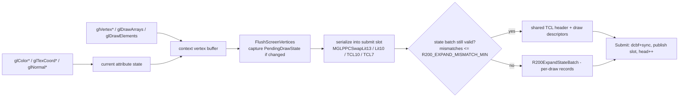
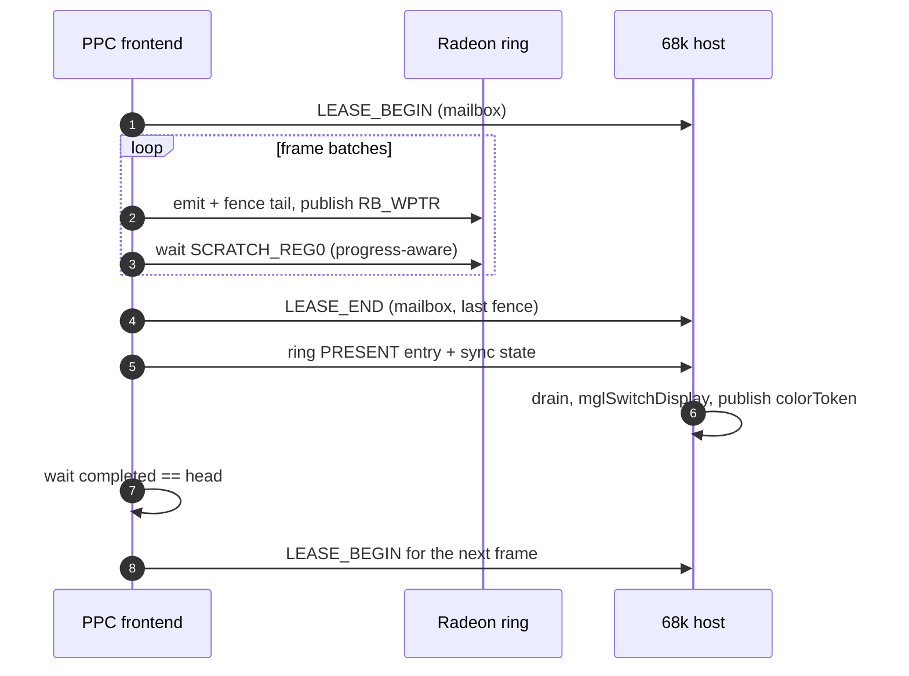

# R200 semantic frontend (PPC DLL internals)

The frontend lives in `backend_r200/library/` and is compiled into one PPC
object. It is a complete GL-1.x state machine that produces bounded *semantic
records*; it never talks to hardware. This document is the map for anyone
changing frontend behaviour.

## 1. Translation unit and layout

`Makefile.dll.r200.gcc` compiles a single object from
`minigl_r200_warpos_compile_probe.c`, which includes `r200_unity.c`. The unity
order is:

```
minigl_r200.c  r200_geometry.c  r200_submit.c  r200_math.c
r200_texture.c r200_surface.c   r200_state.c
```

Rationale: hot geometry/submit/math code is placed together for i-cache
locality, and cross-module helpers (`FloatBits`, budget checks, serializers)
stay inlinable. A previous split-object build was measured ~6% slower on the
68060 classic frontend, and PPC has the same locality concern. Do not split
casually.

`minigl_r200_internal.h` holds `MiniGLR200Context`, the platform services and
all static assertions; `minigl_r200.h` is the public frontend API.

## 2. Context

`struct MiniGLR200Context` (in `minigl_r200_internal.h`, roughly 260 fields)
contains:

- Viewport/scissor, clear values, matrices (modelview/projection stacks),
  current matrix mode.
- Deferred draw state snapshot (`PendingDrawState`), dirty flags and the
  semantic serial counters.
- Vertex/attribute state: current color/normal/texcoords, array pointers and
  strides, vertex buffer, draw batching arrays.
- Texture bindings per unit and texture objects.
- Lighting state (materials, lights, derived matrices), fog, blend, alpha,
  depth, cull, shade model.
- Surfaces (window/fullscreen targets, depth storage, buffer masks, pending
  flip state).
- Platform state: ring/vertex/CP segment pointers, generations, epochs,
  mailbox state, perf counters.
- Texture direct-fill shadow storage for the PPC-side conversion path.

Initialization (`InitializeFrontendContext`/`Lib_mglCreateContext`) sets
viewport/scissor, `clearColor = 0xff000000`, `GL_LESS`, unpack/pack = 4,
`syncEnabled = TRUE`, and monotonic serials/epochs starting at 1. Per-texture
defaults are `NEAREST`/`REPEAT`.

`CreateContext` calls `Radeon3DOpen` and verifies the required capabilities:

```
CP_READY | FENCES | BITMAP_IMPORT | PHASE2_EXECUTE | DEPTH_FUNCS |
TEXTURE_STATE | FOG_MULTITEX | HW_TRANSFORM_CLIP
```

A missing capability fails context creation; it is not silently degraded.

## 3. State capture

- Attribute/state calls mark the context dirty; at flush time
  `CapturePendingDrawState` snapshots everything the driver needs into
  `PendingDrawState`.
- Comparison is length-aware and alignment-checked: a scalar-only change
  compares only the scalar dwords, so the unlit case never pays the lit
  structure cost.
- `BumpSemanticStateSerial` increments the serial used by the host to decide
  whether commit state can be reused. Serial wrap is handled by generation
  checks, not by assuming monotonicity forever.
- No allocation or blocking I/O happens in capture/serialization paths; all
  scratch is context-resident.

## 4. Geometry and serialization

### 4.1 Immediate mode and arrays



- `glBegin/glEnd` and the `glVertex*` family append screen vertices
  (position, packed color, texture coordinates, optional normal index) to the
  context vertex buffer.
- `glDrawArrays`/`glDrawElements` use the same append path; indexed draws have
  a 64K-entry index cache (`indexCacheVerts`, `indexCacheStamp`) that fetches
  each referenced vertex once per draw. The PPC DLL context (`proofContext`)
  allocates it in `ProofIndexCacheAlloc` together with the per-chunk local map
  (`indexLocal`, `indexLocalStamp`). Before 2026-10-21 only the 68k library's
  `CreateContext` allocated it, so on the PPC every drawn index was a full
  vertex fetch (Quake 3 800x600: 46.2 -> 49.5 FPS once it was allocated).
- **Indexed commit draws** (`MGLPPCIndexedDraws`, on while the PPC CP emitter
  is live; `MGLPPC_INDEXED=0` opts out): `DrawElementsIndexed` stages each
  chunk of at most `MAX_SCREEN_VERTICES` (255) triangle-list indices as its
  unique vertices plus a 16-bit index list (`screenIndices`). The flush sizes,
  budgets and validates the chunk as the expanded list it replaces (record
  vertex count = index count, segment reservation = expanded bytes), so every
  capacity check is unchanged; it serializes only the unique vertices, writes
  the index list right after them (little-endian dwords, first index in the
  low half) and records its segment offset in `slot->indexOffsets[draw]`.
  The emitter then fires `DRAW_INDX_2` (`WALK_IND`) + `INDX_BUFFER` (Mesa
  `r200FireEB`) instead of `DRAW_VBUF_2`. Indexed records never merge; a
  chunk with too little reuse to fit inside the reservation, or one that
  lands on the inline (non-commit) path, is expanded back to front in place.
  `COMMIT_DRAW_DWORDS` budgets the 4 extra CP dwords for every commit draw
  while indexed mode is on. Quake 3: vertex bytes per frame roughly halve
  (6.8M fetches for 13.8M indices), 49.8 -> 58.9 FPS.
- `glInterleavedArrays` and the client array pointers feed the same machinery.
  `GLLockArrays`/`GLUnlockArrays` only record the locked range: every draw
  reads all attributes live from the client arrays. Clients (Quake's stage
  iterators) rewrite colour and texture coordinates between `glLockArrays`
  and the draw, and the old per-lock `AllocMem` copy of every vertex cost
  Quake 3 two-pass lightmaps ~30 ms per frame.
- `glClientActiveTextureARB` selects which texture-coordinate array
  (`texcoordArray` for unit 0, `texcoord1Array` for unit 1) `glTexCoordPointer`
  and `GL_TEXTURE_COORD_ARRAY` client state address; `FetchArrayVertex`
  fills `s1/t1` from the unit-1 array, so ARB_multitexture vertex arrays
  (Quake 3 single-pass lightmaps) draw in one pass.
- Multitexture: unit-1 coordinates are captured into a small queue and flushed
  as `MGLDrawMultitexBuffer` before the main draw when needed.
- Indexed `GL_TRIANGLES` (`glDrawElements`) take the fused path
  `AppendResolvedTclVertex`, which appends each resolved vertex straight into
  the TCL staging buffer. A state call between two draws (`glBindTexture`,
  blend, depth...) only bumps `semanticStateSerial`, so the fused path
  re-runs `PrepareScreenAppend` whenever the serial (or the transform request)
  changed since the buffered batch was captured: a real change flushes, a
  normalized-away one keeps appending. Before 2026-10-20 it re-checked only on
  an empty/full buffer or a primitive change, so a draw after a bind joined
  the previous batch with the previous texture (Quake 3 HUD digits sampled the
  portrait texture, wrong world textures). Immediate-mode clients (GLQuake,
  gears) flush at `glEnd` and were not affected.

### 4.2 Serialization kernels

Vertices and TCL records are written to the aperture in the RV280's
little-endian word format. Kernels live in `backend_r200/client/`:

| Kernel | Shape |
|---|---|
| `MGLPPCSwapLit13` | lit vertex, 13 dwords |
| `MGLPPCSwapLit10` | unlit vertex, 10 dwords |
| `MGLPPCSwapTCL10` | TCL record, 10 dwords (hot path) |
| `MGLPPCSwapTCL7` | compact TCL, 7 dwords |
| `SwapTCL9` (`r200_geometry.c`) | compact unlit TCL with unit 1, 9 dwords |

Stride selection is lit-aware. The compact TCL stride (7 dwords) is declared
only for lit/normal-vertex records (`state->normalVertex`), whose normals are
written ahead of the colour so the compact layout matches what the frontend
emits; unlit hardware-TCL records always use the full 10-dword stride. An
unlit compact stride made the service read the unwritten normal dwords as
colour and texture coordinates — a constant texel per primitive (solid 2D
text, white world textures) — so unlit draws never set
`RADEON3D_DRAW_COMPACT_VERTEX` even when
`RADEON3D_CAP_COMPACT_TCL_VERTEX` is available. The one unlit exception is the
9-dword `x,y,z,w,colour,s0,t0,s1,t1` stride (two units, no fog, PPC CP emitter
only): it drops just the trailing fog dword, so every written dword stays in
place. The emitter derives that stride from the record's vertex state once it
is read (`Radeon3DEmitDraw`) and its inline vertex walk skips the fog-slot
zero check for compact strides.

They use `stwbrx` with source stride == record dwords and masks for disabled
attributes. A scalar head/tail plus an AltiVec middle path
(`minigl_ppc_serial_altivec.s`, `minigl_ppc_serial_vector.c`) stages 16-byte
aligned scratch and uses `stvx` for the aligned part of the destination; the
7410 cannot store unaligned vector data directly. See
[performance.md](performance.md#5-cycle-level-data) for the measured
gains.

`FloatBits()` is an inline union pun. Making it out-of-line cost ~24k calls per
frame in an earlier build; keep it inline.

### 4.3 Batching

- **State batch**: one shared TCL header plus up to `MAX_SLOT_DRAWS` (192)
  `{offset, vertexCount}` entries. If more than `R200_EXPAND_MISMATCH_MIN`
  draws (default 4) deviate from the shared header, `R200ExpandStateBatch`
  rewrites the slot as per-draw records.
- **Budget**: `r200_batch_budget.h` exposes `R200SlotPayloadFits` (ring prefix
  + records + state-batch overhead vs the slot limit) and
  `R200ExpandedBatchCost` (compact vs expanded cost, lighting-aware). Callers
  check before emitting, so a batch never overruns the 8192-dword record limit.
- The `mismatchSubmits` counter tracks how often expansion engages; use it when
  tuning `MGLPPC_EXPAND_MIN`. The tool tests under `tools/` exercise the real
  functions.

## 5. Submission

- Two `SubmitSlot`s, each `MAX_RECORD_DWORDS = RADEON3D_MAX_BATCH_DWORDS
  = 8192` dwords and up to 192 draws. One is being filled while the other is in
  flight.
- `Submit()` publishes a slot to the ring with a generation stamp; a slot is
  reusable only when its fence is **retired** (not merely completed), so a slow
  driver never causes a premature overwrite.
- Vertex payloads come from four leased vertex segments. `EnsureStreamSegment`
  / `ReleaseStreamSegment` / `RotateStreamSegments` / `ReapDeferredSegments`
  implement rotation and reclamation. The PPC side must not write a segment
  that the host may still be executing.
- `WaitSubmitSlot`/`WaitAllSubmissions`/`WaitTextureUse` are the blocking
  waits; `glFinish` waits for real retirement through the ring feedback.
- `RecoverDevice` handles a reported device error: pending state is discarded
  and new submissions resume only after the ring is clean.
- `SubmitAndWait` is used by paths that must be synchronous (`glReadPixels`,
  present, teardown).

Generated-size helpers (`Generated*Dwords`) exist so callers can price a
record set before emitting it. Keep them in sync with the emitters when you add
records.

## 6. Surfaces and presentation

- `TargetSurface()` selects the active draw surface:
  fullscreen → `drawBuffer == FRONT ? displayed : drawing`; windowed →
  `surfaces[0]`. `ReadSourceSurface` is symmetric for readback.
- Windowed targets use one surface. Fullscreen uses up to three
  (`screenBuffers[3]`, `mglChooseNumberOfBuffers`), with safe/displayed masks
  and a pending-flip record.
- Present (`mglSwitchDisplay`):
  - flush vertices + `SubmitAndWait`;
  - **BLIT** (default, also required with sync off) copies the drawn buffer to
    the visible one;
  - **FLIP** (fullscreen, sync on) changes the display buffer; it can submit
    while the switch is outstanding with 3 buffers.
  - single-buffer mode is a diagnostic path (visual tearing, no hidden
    buffer).
- Depth storage pitch is padded: 16-bit depth uses a 256-byte pitch to satisfy
  driver tiling; `DepthStorageWidth()` owns the rule. Scissor/draw-rect remain
  client-visible, so the padding is transparent.
- `glClear`/`glReadPixels`/`glFlush`/`glFinish`/`glGetError` live in this
  module; readback is a synchronous path.

## 7. Textures (summary)

Detailed in [textures.md](textures.md). The frontend keeps `TextureObject`s
with image/shadow storage, dirty-level masks and rects, residency generations,
device epoch, content/last-use serials and a fence, plus a `queuedBatchSerial`
for deferred uploads. Eviction is ownership/fence based
(`ReapDeferredSurfaces`), not "last historical fence".

Repeated `glTexSubImage2D` on a shadow-backed POT texture (Quake lightmap
atlases) has two CP-path accelerations (2026-10-20):

- **Parked re-commit.** With `TEXTURE_DIRECT_PARK` the direct re-commit waits
  only for the host to consume the ring (`completed == head`,
  `FrontendWaitRingConsumed`) instead of `R200PPCPlatformBarrier(FALSE)`
  (`retired == head`). The host parks the replaced residency and frees it
  once everything retired. `MGLPPC_NOPARK=1` restores the drain.
- **Lightmap surface pool** (`FrontendLmPoolUpdate`). From a texture's second
  subimage it gets 3 holder surfaces: library textures under reserved names
  from `MAX_TEXTURES-1` down, created once through direct BEGIN/COMMIT, with
  descriptors in a 256-entry hash consulted before the descriptor cache.
  An update needs no 68k call:
  1. Patch the shadow.
  2. Stamp the current slot's last use as `head + 1`; the records naming it
     can only go into the next entry, since one Submit publishes exactly one
     entry.
  3. Pick a retired slot that is not current, publishing only if every
     candidate waits on the unpublished entry.
  4. Copy the rows changed since that slot was last written (8-update
     history, else the full image) with plain stores, and flush.
  5. Re-point the texture's token at the slot.

  A slot is never rewritten while current or before its last sampling
  retired; that is the reuse discipline the free/re-import path already
  relied on for this GPU's non-invalidating texture cache. A redefinition
  (token no longer the current slot) forces full rewrites.
  `MGLPPC_NOPOOL=1` disables the pool.

## 8. Submission feedback and the device epoch

Ring control publishes `head`, `completed`, `retired`, `presentSeq` and
`error`; the frontend polls it with a bounded spin (`MGLPPCYield` after a fixed
poll budget) and consumes `retired` to reuse slots/segments. Device resets
bump the device epoch; resources tagged with an older epoch are rebuilt rather
than reused, and `STALE_GENERATION`/`VERIFY_FAILED` statuses surface protocol
mistakes.

## 9. Perf clock

On PPC, `PerfClock`/`PerfRate` use the 7410 timebase (`mftb`) calibrated once
against `Delay(2)`/`ReadEClock`. The initial calibration is approximate; the
profiling harnesses re-calibrate against a whole-run wall measurement. Session
values around 24.6–25.0 MHz have been observed — always treat the rate as
per-boot data, never as a constant. See
[performance.md](performance.md#1-how-to-read-these-numbers).

## 10. CP-emitter mode (opt-in)

With `MGLPPC_CPEMIT=1` the frontend bypasses semantic records for draws and
instead builds driver-format command packets in a leased 256 KiB CP segment,
using the shared `radeon3d_emit.c`. `MGLPPCEmitBatch` accepts up to 8192 dwords
and 192 draws, publishes `[byteOffset, dwordCount, vertexSegmentMask]`, and
packs batches into the CP segment as a FIFO (`CpRingReserve`, ring control
v7): a batch's space is reused only after its entry retires, and the PPC may
run up to 32 entries ahead of retirement. Surface descriptors are cached in a
4-way set-associative table (`MGLPPC_CP_SLOTS`, default 2048; round-robin
victim per set) and invalidated on resource/lifecycle changes; the old
128-entry table thrashed on Quake 3 lightmaps (3,541 misses per demo, 45.2
FPS) where the set-associative one misses 260 times (50.6 FPS). The host
binding shadow (`hostShadowTexture`) mirrors the binding of the **active**
texture unit; mirroring unit 0 only let a unit-1 bind reuse a stale handle
(a 256x256 lightmap resolved to a 16x7 surface, emit stage 0x58). Fullscreen BLIT is
validated; FLIP has a documented race. Deep spec:
[reference/CP_EMITTER.md](reference/CP_EMITTER.md).

### 10.1 PPC engine lease (opt-in, `MGLPPC_LEASE=1`)

With the interface-20 lease the frontend writes CP batches straight into the
Radeon ring and publishes `RB_WPTR` itself (`SubmitLeaseBatch`); the 68k host
keeps the control plane (textures, surfaces, presentation). Requires
`MGLPPC_CPEMIT=1` and a driver offering `RADEON3D_CAP_PPC_RING`.

- **Waits** (`R200LeaseWaitStep`, reserve and fence): spin while
  `RB_RPTR`/`SCRATCH_REG0` move, pump the heartbeat every 256 polls, park
  (`MGLPPCYield`, a ~20 ms tick) only after `MGLPPC_RING_YIELD_SPINS` polls
  with no movement, fail only after 1 s of wall time with no movement. The
  first version yielded on the first unsuccessful poll, which parked every
  batch for a tick.
- **Release before present** (C1): the host owns the display switch and the
  buffer rotation, and only answers `CP_SURFACE` for its live drawing
  target. A frame rendered under the lease would stamp a target the host has
  already rotated past (emitter stage 60). So a ring PRESENT first sends
  `LEASE_END`; the next batch waits (`R200PPCLeaseResume`, same wait policy)
  until the host has consumed the present (`completed == head`), then takes
  the lease again. The present entry also carries the frame's sync state:
  a frame without bounded entries otherwise left the host on the library's
  sync-on default, a vblank flip per frame.
- Lease commands travel the mailbox when the host advertises
  `MGLPPC_CAP_MAILBOX_LEASE` ([transport-protocol.md](transport-protocol.md#5-mailbox)).
- Each batch still ends with a `WAIT_IDLE` fence tail and a local
  retirement wait. `MGLPPC_LEASE_NOIDLE`/`NOPRESENT` exist to measure the
  ceiling. The 2026-10-20 result: with no presents and one batch in flight
  gears reaches ~200-210 fps, limited by ~4.3 ms of PPC CPU per frame, not
  by the 68k or the GPU. See [performance.md](performance.md).
- Teardown writes one `LEASESTAT` line (batches, handovers, parks and
  fence/end/begin/resume microseconds) to `DH2:leasestat.log`; a failed lease
  emit appends its emitter stage and descriptor-resolve reason to
  `DH2:cpfail.log`.



### 10.2 Wait yield policy and colour-suppressed draws (2026-10-20)

- **Yield only after a real stall.** `MGLPPCYield` (`client/minigl_ppc_yield.c`)
  is called from every bounded wait loop. It now parks (`WaitTime`, which
  costs a whole ~20 ms tick, not the requested 100 us) only once the current
  wait has lasted `MGLPPC_RING_YIELD_SPIN_TICKS` (500000 time-base ticks,
  ~15-20 ms). Calls less than `MGLPPC_RING_YIELD_GAP_TICKS` apart count as
  the same wait; earlier calls return at once and the caller keeps
  spinning. At 800x600 Quake, 150 parks used to cost 2.2 s of a 19.8 s run.
- **Depth-only clears use the plane mask.** RB3D_PLANEMASK is ignored unless
  `R200_PLANE_MASK_ENABLE` (RB3D_CNTL bit 1) is set. The emitter now sets it
  for colour-suppressed draws, so a depth-only clear (`gl_ztrick 0`) is a
  pure depth write instead of a full-screen colour read-modify-write
  (~2.5 ms/frame at 800x600). The older no-op-blend workaround stays behind
  `MGLPPC_CLEARBLEND=1`.

### 10.3 Macro-tiled colour target (`MINIGL_CTILE=1`, 2026-10-21)

At 1024x768 Quake 3 is fill-bound (a quarter-size view runs 39 -> 54 FPS)
and the linear colour buffer is the expensive part (32-bit colour halves the
frame rate; texture depth and picmip barely matter). With `MINIGL_CTILE=1`
the 68k library's fullscreen setup (`SetupTiledColorTarget`) replaces the
drawing buffer with a separate bitmap two rows taller whose start is moved
up to the next 2 KiB boundary: macro-tiled addressing needs that alignment
and a pitch of whole 256-byte rows, and the P96 screen buffers start at
64-byte boundaries (an unaligned tiled target renders in shifted vertical
blocks with striped rows). The surface and present descriptors carry
`MGL_R200_SURFACE_FORMAT_TILED` (bit 31 of `format`); `MGLPPCResolveSurface`
strips it into `Radeon3DEmitSurface.Tiled`, which sets
`R200_COLOR_TILE_ENABLE` in `RB3D_COLORPITCH`, and the host present untiles
the copy. Quake 3 1024x768x16 with dynamic lights: 39.3 -> 50.0 FPS.

Opt-in only: native 68k clients render through the library's own path and
present with a CPU-side blit, both linear; CPU readers of the drawing buffer
(`glReadPixels`, `mglLockBack`, the `MGLPPC_SHOT_EVERY` dump) see tiled data.
Micro tiling (bit 17) scrambles the 2D untile copy and is slower.

## 11. Frontend environment knobs

| Variable | Effect |
|---|---|
| `MGLPPC_VERBOSE` | console output |
| `MGLPPC_CPEMIT` | CP-emitter mode |
| `MGLPPC_LEASE` | take the interface-20 PPC engine lease (needs `MGLPPC_CPEMIT`; section 10.1) |
| `MGLPPC_LEASE_NOPRESENT` | diagnostic: skip presents while the lease is held (ceiling test) |
| `MGLPPC_LEASE_NOIDLE` | diagnostic: `1` drops the per-batch `WAIT_IDLE`, `2` also keeps one batch in flight (release submits a full idle fence first) |
| `MGLPPC_IBSMOKE` | IB smoke probe after ring registration (never with CPEMIT) |
| `MGLPPC_BATCH` | opt-in batched two-tile direct upload |
| `MGLPPC_BATCHDIAG` | batch diagnostics to `DH2:wosbuild/batchdiag.txt` |
| `MGLPPC_FORCENORMAL` | force normal renormalization (diagnostic) |
| `MGLPPC_NOALTIVEC` / `MGLPPC_ALTIVEC` | force scalar / vector serialization |
| `MGLPPC_VERIFY` | read back and compare AltiVec results |
| `MGLPPC_PROFILE` | frontend profiler buckets (profile builds only) |
| `MGLPPC_NOPARK` | `1`: subimage re-commits drain the GPU instead of parking the old residency (A/B) |
| `MGLPPC_NOPOOL` | `1`: no PPC-owned lightmap surface pools (A/B) |
| `MGLPPC_FORCEMIP` | `1`: a `GL_LINEAR`-minified texture with a complete app-uploaded mip chain samples the chain (`LINEAR_MIPMAP_NEAREST`); read at platform open. Breaks pictures that upload only level 0 (Quake HUD/console) |
| `MGLPPC_CLEARBLEND` | `1`: restore the old depth-only clear workaround (no-op blend `SRC=ZERO, DST=ONE` + full state re-emit) instead of `R200_PLANE_MASK_ENABLE` |
| `MGLPPC_BATCHDW` | diagnostic: cap the CP batch budget in dwords (>= 1024); used to measure per-IB cost |
| `MGLPPC_INDEXED` | `0`: disable indexed commit draws (`DRAW_INDX_2`, section 4.1); default on with the CP emitter |

## 12. Invariants to preserve

- No heap allocation, file I/O or console output in a frame path.
- No large stack buffers (the client CLI stack may be 4 KiB; the frontend has
  seen 1 MiB stacks in benchmarks but must not require them).
- All shared-memory writes are published with a cache flush + barrier before
  the host is signalled.
- All aperture writes are 4-byte aligned; 32-byte alignment is preferred for
  vector stores and segment bases.
- No raw hardware access: no PCI, MMIO, CP ring or VRAM addressing from PPC.
- Every new record/batch respects the 8192-dword and 192-draw bounds.

### 4.3 Scalar serializers use register-swap stores, not stwbrx (2026-10-15)

`minigl_ppc_serial.s` no longer uses `stwbrx`: all 40 store sites now
byte-reverse in registers (`rlwinm`/`rlwimi` into `r0`, a volatile scratch)
and store with plain `stw`. Measured on the reference machine
(p96-driver docs/10, tools/phase4): `stwbrx` to the VRAM aperture ~60 ns/dword,
register-swapped plain stores ~42 ns/dword — adjacent normal stores are
write-gathered by the 60x bus/bridge, byte-reversed stores are not. The
AltiVec double-pass path (`minigl_ppc_serial_altivec.*`) is unchanged and
remains off by default (`MGLPPC_NOALTIVEC=1` from `mglhost`); enable with
`MGLPPC_ALTIVEC=1` for machines where the vector move wins.

Client environment protocol (measured the hard way): `mglhost` (re)writes its
defaults into `ENV:` at startup (`MGLPPC_CPEMIT=1`, `MGLPPC_NOALTIVEC=1`,
`MGLPPC_HOSTPRI=-1`), so set client env vars AFTER the host is up; and on
this OS build `UnSet` does not reliably remove a variable — use
`Delete ENV:<name>` and verify with `GetEnv`.
