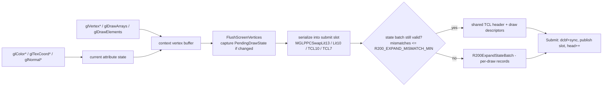

# R200 semantic frontend (PPC DLL internals)

The frontend lives in `backend_r200/library/` and is compiled into one PPC
object. It is a complete GL-1.x state machine that produces bounded *semantic
records*; it never talks to hardware. This document is the map for anyone
changing frontend behaviour.

## 1. Translation unit and layout

`Makefile.dll.r200.gcc` compiles a single object from
`minigl_r200_warpos_compile_probe.c`, which includes `r200_unity.c`. The unity
order is:

```
minigl_r200.c  r200_geometry.c  r200_submit.c  r200_math.c
r200_texture.c r200_surface.c   r200_state.c
```

Rationale: hot geometry/submit/math code is placed together for i-cache
locality, and cross-module helpers (`FloatBits`, budget checks, serializers)
stay inlinable. A previous split-object build was measured ~6% slower on the
68060 classic frontend, and PPC has the same locality concern. Do not split
casually.

`minigl_r200_internal.h` holds `MiniGLR200Context`, the platform services and
all static assertions; `minigl_r200.h` is the public frontend API.

## 2. Context

`struct MiniGLR200Context` (in `minigl_r200_internal.h`, roughly 260 fields)
contains:

- Viewport/scissor, clear values, matrices (modelview/projection stacks),
  current matrix mode.
- Deferred draw state snapshot (`PendingDrawState`), dirty flags and the
  semantic serial counters.
- Vertex/attribute state: current color/normal/texcoords, array pointers and
  strides, vertex buffer, draw batching arrays.
- Texture bindings per unit and texture objects.
- Lighting state (materials, lights, derived matrices), fog, blend, alpha,
  depth, cull, shade model.
- Surfaces (window/fullscreen targets, depth storage, buffer masks, pending
  flip state).
- Platform state: ring/vertex/CP segment pointers, generations, epochs,
  mailbox state, perf counters.
- Texture direct-fill shadow storage for the PPC-side conversion path.

Initialization (`InitializeFrontendContext`/`Lib_mglCreateContext`) sets
viewport/scissor, `clearColor = 0xff000000`, `GL_LESS`, unpack/pack = 4,
`syncEnabled = TRUE`, and monotonic serials/epochs starting at 1. Per-texture
defaults are `NEAREST`/`REPEAT`.

`CreateContext` calls `Radeon3DOpen` and verifies the required capabilities:

```
CP_READY | FENCES | BITMAP_IMPORT | PHASE2_EXECUTE | DEPTH_FUNCS |
TEXTURE_STATE | FOG_MULTITEX | HW_TRANSFORM_CLIP
```

A missing capability fails context creation; it is not silently degraded.

## 3. State capture

- Attribute/state calls mark the context dirty; at flush time
  `CapturePendingDrawState` snapshots everything the driver needs into
  `PendingDrawState`.
- Comparison is length-aware and alignment-checked: a scalar-only change
  compares only the scalar dwords, so the unlit case never pays the lit
  structure cost.
- `BumpSemanticStateSerial` increments the serial used by the host to decide
  whether commit state can be reused. Serial wrap is handled by generation
  checks, not by assuming monotonicity forever.
- No allocation or blocking I/O happens in capture/serialization paths; all
  scratch is context-resident.

## 4. Geometry and serialization

### 4.1 Immediate mode and arrays



- `glBegin/glEnd` and the `glVertex*` family append screen vertices
  (position, packed color, texture coordinates, optional normal index) to the
  context vertex buffer.
- `glDrawArrays`/`glDrawElements` use the same append path; indexed draws have
  a small index cache (`indexCacheVerts`, `indexCacheStamp`).
- `glInterleavedArrays` and the client array pointers feed the same machinery;
  `GLLockArrays`/`GLUnlockArrays` are honoured.
- Multitexture: unit-1 coordinates are captured into a small queue and flushed
  as `MGLDrawMultitexBuffer` before the main draw when needed.

### 4.2 Serialization kernels

Vertices and TCL records are written to the aperture in the RV280's
little-endian word format. Kernels live in `backend_r200/client/`:

| Kernel | Shape |
|---|---|
| `MGLPPCSwapLit13` | lit vertex, 13 dwords |
| `MGLPPCSwapLit10` | unlit vertex, 10 dwords |
| `MGLPPCSwapTCL10` | TCL record, 10 dwords (hot path) |
| `MGLPPCSwapTCL7` | compact TCL, 7 dwords |

They use `stwbrx` with source stride == record dwords and masks for disabled
attributes. A scalar head/tail plus an AltiVec middle path
(`minigl_ppc_serial_altivec.s`, `minigl_ppc_serial_vector.c`) stages 16-byte
aligned scratch and uses `stvx` for the aligned part of the destination; the
7410 cannot store unaligned vector data directly. See
[performance.md](performance.md#5-cycle-level-data) for the measured
gains.

`FloatBits()` is an inline union pun. Making it out-of-line cost ~24k calls per
frame in an earlier build; keep it inline.

### 4.3 Batching

- **State batch**: one shared TCL header plus up to `MAX_SLOT_DRAWS` (192)
  `{offset, vertexCount}` entries. If more than `R200_EXPAND_MISMATCH_MIN`
  draws (default 4) deviate from the shared header, `R200ExpandStateBatch`
  rewrites the slot as per-draw records.
- **Budget**: `r200_batch_budget.h` exposes `R200SlotPayloadFits` (ring prefix
  + records + state-batch overhead vs the slot limit) and
  `R200ExpandedBatchCost` (compact vs expanded cost, lighting-aware). Callers
  check before emitting, so a batch never overruns the 8192-dword record limit.
- The `mismatchSubmits` counter tracks how often expansion engages; use it when
  tuning `MGLPPC_EXPAND_MIN`. The tool tests under `tools/` exercise the real
  functions.

## 5. Submission

- Two `SubmitSlot`s, each `MAX_RECORD_DWORDS = RADEON3D_MAX_BATCH_DWORDS
  = 8192` dwords and up to 192 draws. One is being filled while the other is in
  flight.
- `Submit()` publishes a slot to the ring with a generation stamp; a slot is
  reusable only when its fence is **retired** (not merely completed), so a slow
  driver never causes a premature overwrite.
- Vertex payloads come from four leased vertex segments. `EnsureStreamSegment`
  / `ReleaseStreamSegment` / `RotateStreamSegments` / `ReapDeferredSegments`
  implement rotation and reclamation. The PPC side must not write a segment
  that the host may still be executing.
- `WaitSubmitSlot`/`WaitAllSubmissions`/`WaitTextureUse` are the blocking
  waits; `glFinish` waits for real retirement through the ring feedback.
- `RecoverDevice` handles a reported device error: pending state is discarded
  and new submissions resume only after the ring is clean.
- `SubmitAndWait` is used by paths that must be synchronous (`glReadPixels`,
  present, teardown).

Generated-size helpers (`Generated*Dwords`) exist so callers can price a
record set before emitting it. Keep them in sync with the emitters when you add
records.

## 6. Surfaces and presentation

- `TargetSurface()` selects the active draw surface:
  fullscreen → `drawBuffer == FRONT ? displayed : drawing`; windowed →
  `surfaces[0]`. `ReadSourceSurface` is symmetric for readback.
- Windowed targets use one surface. Fullscreen uses up to three
  (`screenBuffers[3]`, `mglChooseNumberOfBuffers`), with safe/displayed masks
  and a pending-flip record.
- Present (`mglSwitchDisplay`):
  - flush vertices + `SubmitAndWait`;
  - **BLIT** (default, also required with sync off) copies the drawn buffer to
    the visible one;
  - **FLIP** (fullscreen, sync on) changes the display buffer; it can submit
    while the switch is outstanding with 3 buffers.
  - single-buffer mode is a diagnostic path (visual tearing, no hidden
    buffer).
- Depth storage pitch is padded: 16-bit depth uses a 256-byte pitch to satisfy
  driver tiling; `DepthStorageWidth()` owns the rule. Scissor/draw-rect remain
  client-visible, so the padding is transparent.
- `glClear`/`glReadPixels`/`glFlush`/`glFinish`/`glGetError` live in this
  module; readback is a synchronous path.

## 7. Textures (summary)

Detailed in [textures.md](textures.md). The frontend keeps `TextureObject`s
with image/shadow storage, dirty-level masks and rects, residency generations,
device epoch, content/last-use serials and a fence, plus a `queuedBatchSerial`
for deferred uploads. Eviction is ownership/fence based
(`ReapDeferredSurfaces`), not "last historical fence".

## 8. Submission feedback and the device epoch

Ring control publishes `head`, `completed`, `retired`, `presentSeq` and
`error`; the frontend polls it with a bounded spin (`MGLPPCYield` after a fixed
poll budget) and consumes `retired` to reuse slots/segments. Device resets
bump the device epoch; resources tagged with an older epoch are rebuilt rather
than reused, and `STALE_GENERATION`/`VERIFY_FAILED` statuses surface protocol
mistakes.

## 9. Perf clock

On PPC, `PerfClock`/`PerfRate` use the 7410 timebase (`mftb`) calibrated once
against `Delay(2)`/`ReadEClock`. The initial calibration is approximate; the
profiling harnesses re-calibrate against a whole-run wall measurement. Session
values around 24.6–25.0 MHz have been observed — always treat the rate as
per-boot data, never as a constant. See
[performance.md](performance.md#1-how-to-read-these-numbers).

## 10. CP-emitter mode (opt-in)

With `MGLPPC_CPEMIT=1` the frontend bypasses semantic records for draws and
instead builds driver-format command packets in a leased 256 KiB CP segment,
using the shared `radeon3d_emit.c`. `MGLPPCEmitBatch` accepts up to 8192 dwords
and 192 draws, publishes `[byteOffset, dwordCount, vertexSegmentMask]`, and
reuses slices only after retirement. Surface descriptors are cached (default
128) and invalidated on resource/lifecycle changes. Fullscreen BLIT is
validated; FLIP has a documented race. Deep spec:
[reference/CP_EMITTER.md](reference/CP_EMITTER.md).

## 11. Frontend environment knobs

| Variable | Effect |
|---|---|
| `MGLPPC_VERBOSE` | console output |
| `MGLPPC_CPEMIT` | CP-emitter mode |
| `MGLPPC_IBSMOKE` | IB smoke probe after ring registration (never with CPEMIT) |
| `MGLPPC_BATCH` | opt-in batched two-tile direct upload |
| `MGLPPC_BATCHDIAG` | batch diagnostics to `DH2:wosbuild/batchdiag.txt` |
| `MGLPPC_FORCENORMAL` | force normal renormalization (diagnostic) |
| `MGLPPC_NOALTIVEC` / `MGLPPC_ALTIVEC` | force scalar / vector serialization |
| `MGLPPC_VERIFY` | read back and compare AltiVec results |
| `MGLPPC_PROFILE` | frontend profiler buckets (profile builds only) |

## 12. Invariants to preserve

- No heap allocation, file I/O or console output in a frame path.
- No large stack buffers (the client CLI stack may be 4 KiB; the frontend has
  seen 1 MiB stacks in benchmarks but must not require them).
- All shared-memory writes are published with a cache flush + barrier before
  the host is signalled.
- All aperture writes are 4-byte aligned; 32-byte alignment is preferred for
  vector stores and segment bases.
- No raw hardware access: no PCI, MMIO, CP ring or VRAM addressing from PPC.
- Every new record/batch respects the 8192-dword and 192-draw bounds.
