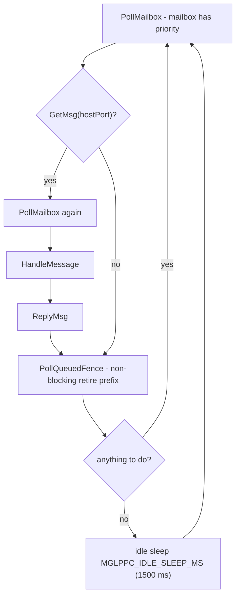

# The 68k host (`minigl_ppc_host`)

`backend_r200/minigl_ppc_host.c` is the 68k half of the direct-R200 stack. It
is a plain AmigaDOS process (`-noixemul`, built `-mcpu=68060`) that owns the
message port `MiniGLPPC.R200.Host.1`, executes ring work through
`minigl.library`'s direct-R200 backend, manages fences and presentation, and
answers synchronous queries. It contains no GL semantics beyond what the
service needs.

## 1. Startup and lifecycle

1. Reads its runtime options (`MGLPPC_FENCE_GROUP`, `MGLPPC_HOSTPRI`,
   `MGLPPC_NOMAILBOX`, `MGLPPC_NODIRECT`, `MGLPPC_IBDRY`, upload trace).
2. Opens timer/EClock services and creates the public port.
3. Initializes `MGLPPCHostState`: semantic slot state (`semanticSlots[2]`,
   generation/epoch), fence list (`semanticFence`, `fenceValue`, `fenceSerial`,
   in-flight mask, group size/count/coalesce), ring state (`ringEpoch`,
   `ringCompleted`, `lastGeneration[8]`), vertex segment ids (4), optional CP
   segment, staging buffer pointers, `displayLocked`, `verboseUploads`.
4. Serves messages until SHUTDOWN or client teardown, then
   `DiscardSemantic(&state, FALSE)` and exits.

One host per client run. The client's normal close shuts the host down; a
missing host makes clients hang on the absent port, and a stale host from a
previous run makes the client open an old service. The main loop sleeps
`MGLPPC_IDLE_SLEEP_MS` (1500 ms) when idle, so a mailbox request can wait for
one sleep quantum if it arrives right after the host parks. A
frequently-idle host therefore adds up to ~20 ms to a begin-upload call
(measured); this is why the U0 fix keeps the present/fence pipeline warm.

## 2. Main loop



```
for (;;) {
    PollMailbox(&state);            /* before each wait and each message */
    if (message = GetMsg(hostPort)) {
        PollMailbox(&state);        /* mailbox has priority over Exec */
        HandleMessage(message, &state);
        ReplyMsg(message);
    }
    PollQueuedFence(&state);        /* non-blocking prefix retirement   */
    idle sleep if nothing to do
}
```

Mailbox handling is deliberately checked before the Exec message path: the
mailbox is the latency-critical channel.

## 3. Message handlers (`HandleMessage`)

| Command | Host action |
|---|---|
| HELLO | negotiate protocol/caps, echo capabilities |
| CREATE_CONTEXT | `mglCreateContext(0, 0, ...)` on the 68k backend; allocate/validate surfaces |
| DESTROY_CONTEXT / SHUTDOWN | discard semantic state, release segments and staging, exit on shutdown |
| EXECUTE_BATCH (legacy 1–32 opcodes) | interpret the v9 replay batch (legacy clients only) |
| GEN/DELETE_TEXTURES | texture object bookkeeping |
| TEXTURE_UPLOAD_BEGIN/CHUNK/END | chunked Exec upload, CRC-first-only when negotiated |
| GET_INTEGER | query backend values |
| VRAM_PROBE_* | 64 KiB / 64-pass read-write probe with dual sentinels |
| REGISTER/EXECUTE/BARRIER/UNREGISTER_SEMANTIC | semantic slots (legacy path) |
| BIND_TEXTURE | bind/normalize a texture for the backend |
| REGISTER_SEMANTIC_RING | validate `count==32` (`MGLPPC_RING_SLOTS`), `slotDwords==8192`; lease 64 KiB ring + 4 vertex segments + optional 256 KiB CP segment; init control block, mailbox at +4096; echo `HOST_EVENTS/MAILBOX/INDIRECT/IB_DRY/CP_EMIT` |
| TEXTURE_UPLOAD_SHARED | validate staging, invalidate, upload, reply |
| TEXTURE_DIRECT_BEGIN/COMMIT/ABORT | direct-fill lease/commit (with epoch validation) |
| TEXTURE_DIRECT_BEGIN2/COMMIT2 | batched two-tile variant (capability-gated, diagnostics) |
| SUBIMAGE_SHARED | shared subimage upload (native path gated by the `0x54580100` tag and `SUBIMAGE_DIRECT_BGRA`) |
| READ_PIXELS_SHARED | readback into shared staging, RGBA/UBYTE, ≤2 MiB |
| CP_SURFACE | read-only surface descriptor query for the CP cache |
| CLEAR_PRESENT | clear + present combination |

## 4. Ring execution pipeline

`PollRingEntries`:

1. `CacheClearE` the entries and payload lines.
2. For each new entry, validate generation and flags.
3. `INDIRECT`/`CP_EMIT` entries go to `ExecuteCpEntry`, which checks
   `colorToken`, drains the semantic fence when required, and submits the
   PPC-built packet slice through `Radeon3DExecute`.
4. Commit/state-batch entries decode to driver calls
   (`Radeon3DExecute` with decoded records).
5. On PRESENT entries it calls `mglSwitchDisplay`, publishes
   `PublishCpColorTarget` (v6 color target), and advances
   `presentSeq`.
6. `PublishRetired`/`AdvanceRetired` update the control block only after
   fences complete.

The host also validates the IB smoke entry (`offset == 8192 && count == 8`) on
registration and supports a dry-run echo (`IB_DRY`) that proves the wiring
without executing.

## 5. Fences, retirement and epochs

- `RecordFence` / `PopFence` / `ClearFences` maintain the outstanding list.
- `CloseFenceGroup` issues a fence-only kick so retirement progresses without a
  full submission.
- `DrainSemanticFence` is the blocking wait used before operations that must
  not race (present with sync, readback, teardown). `TEXTURE_DIRECT_BEGIN`
  skips it when the client sends `MGLPPC_TEXDIRECT_REQ_PARK_OLD` (capability
  `TEXTURE_DIRECT_PARK`): the library parks the replaced residency
  (`MGL_R200_TEXDIRECT_FLAG_PARKED`) and the host counts it. Past 64 parked
  residencies BEGIN drains as before.
- `ReapParkedSurfaces` frees the parked residencies through
  `MGL_R200_PRIVATE_TEXDIRECT_REAP_V1` once nothing can sample them: ring
  fully consumed, no queued fence, no fence-less run, no absorbed records.
  It runs from `PollQueuedFence` and after every `DrainSemanticFence`, so
  the library's release (which waits on the device's newest fence) never
  stalls.
- `DrainForSegment` waits for every fence that references a segment before it
  is reused.
- `PollQueuedFence` is non-blocking: it retires the contiguous completed prefix
  and publishes it. With multi-fence support the host may queue one submission
  per ring slot; without it, only the latest fence is waitable and the host
  serializes.
- `ringEpoch`/`semanticEpoch`/`deviceEpoch` are compared against resource tags;
  a mismatch is rejected as `STALE_GENERATION`.

Present sequencing is tracked separately from texture-use fences so a texture
re-upload never waits on a flip.

## 6. Memory and segments

- The host never touches PCI, MMIO or VRAM directly; all GPU memory comes from
  the backend's private segment queries (`Radeon3DSegment`-style leases) for
  the ring, vertex segments and CP segment.
- Exec-path transfers use `AllocVec(MEMF_ANY)` staging buffers with
  `CacheClearE(..., CACRF_ClearD)` before publishing and after receiving.
  Staging is bounded and pooled per transfer type, not allocated per frame.
- 68k alignment: the host compiles with normal 68k alignment. Data coming from
  PPC (`-amiga-align` 2-byte `ULONG` arrays on the WarpOS side) is copied into
  service-owned, naturally aligned staging before the backend sees it; never
  pass a packed PPC buffer straight into a 68k API expecting 4-byte alignment.

## 7. Presentation and surfaces

**CP-queued present (`MGLPPC_CPPRESENT=1`, opt-in).** For a fullscreen
BLIT-mode present the host asks the library (`MGL_R200_PRIVATE_PRESENT_V1_QUERY`)
to run `mglSwitchDisplay()`'s BLIT branch without the copy and to report
the back buffer and the screen bitmap. It then writes an 18-dword 2D blit IB
(`WAIT_UNTIL` 2D/3D idle-clean, `DP_GUI_MASTER_CNTL`, write mask,
`DP_CNTL`, src/dst `PITCH_OFFSET`, `SRC_Y_X`/`DST_Y_X`, `DST_HEIGHT_WIDTH`)
into one of four fenced 256-byte slots at ring-segment offset 12288. It
dispatches the IB like the startup IB smoke, and records its fence under
the PRESENT entry. A surface start that is not 1 KiB aligned moves into
the X/Y origin, as in the driver's 2D surfaces. There is no
`DrainSemanticFence` and no `WaitBlit`; the dispatch tail's idle-clean
waits order the copy between frames on the GPU, and the driver marks
`Need2DRestore` so Picasso96 re-syncs its 2D state. FLIP, windowed, sync
without BLIT, and unaligned layouts take the old path. Shutdown prints
`CP_PRESENT queued/not_eligible/cpu_copies` with the first fallback reason.
A present source marked `MGL_R200_SURFACE_FORMAT_TILED` (the
`MINIGL_CTILE=1` render target, frontend-r200.md section 10.3) is copied
with the SRC macro-tile bit (`SRC_PITCH_OFFSET` bit 30), which untiles it
into the linear screen bitmap; a tiled source must start on a 2 KiB
boundary (fallback reason 5 otherwise).

- Windowed present is a bounded P96 blit from the drawn surface.
- Fullscreen present is BLIT (default) or FLIP when sync is on; FLIP uses
  `ChangeScreenBuffer`, which measured ~22–27 ms per call versus ~0.14 ms for
  the notification wait — a known cost of the sync path.
- `PublishCpColorTarget` (ring v6) tells the PPC which target is live after a
  display change; the PPC re-stamps target dwords in subsequent CP batches.
- The host `displayLocked` flag guards locking (`mglLockBack`, lock mode)
  against presentation.

## 8. Runtime options and build flags

Runtime (`GetVar`):

| Variable | Effect |
|---|---|
| `MGLPPC_HOSTPRI` | `SetTaskPri` for the host (use `-1` for throughput; a reboot clears it) |
| `MGLPPC_FENCE_GROUP` | fence coalescing group size |
| `MGLPPC_NOMAILBOX` | disable mailbox |
| `MGLPPC_NODIRECT` | disable direct texture paths |
| `MGLPPC_IBDRY` | IB smoke dry-run |
| `MGLPPC_UPLOAD_TRACE` | per-upload trace (diagnostic; the name is constructed at runtime so the literal cannot leak into the binary) |
| `MGLPPC_VERBOSE` | PPC-side console gate |
| `MGLPPC_CPPRESENT` | `1`: fullscreen BLIT presents are queued on the CP as a 2D-blit IB (section 7) instead of drain + CPU blit; read at host start |
| `MGLPPC_BLITDIAG` | diagnostic: `1` makes the CP-queued present copy one pixel (measures present-blit cost); read at host start |

Compile-time (`Makefile.dll.r200.gcc`):

| Define | Default | Effect |
|---|---|---|
| `MGLPPC_HOST_TRACE` | 0 | per-line log to `DH2:wosbuild/mglppc_host.log` + 2 s console reports |
| `MGLPPC_PROFILE` | 0 | session counters (control/barrier/mailbox/ring ticks, uploads, subimage breakdown) printed at shutdown |
| `MGLPPC_PACING` | 0 | EClock present histogram |
| `MGLPPC_IDLE_DIAG` | 0 | idle sleep counters |
| `MGLPPC_HOST_DBG` | 0 | timed `DH2:hostdbg.log` markers: SLOW handler/ring_poll, ring STALL signature, HB summaries (up to eight EClock reads per loop pass); plus `HOST_LEASESTAT` shutdown lines (lease acquire/release, release-to-present gap, present drain/switch, command route, loop period) |
| `MGLPPC_HOST_TARGET_CACHE` | 1 | cache target-surface queries (V2 bridge) |
| `MGLPPC_INFLIGHT_SLOTS` | unset | 1 = conservative drain-per-dispatch model (A/B only) |

## 9. Logging and profiling rules

- All trace loggers are compiled out by default. The per-line logger opens,
  seeks, writes and closes for every line; it is a diagnostic tool only.
- Console output dominates frame time (console.device writes). For benchmark
  runs, leave `MGLPPC_VERBOSE`/`MGLPPC_UPLOAD_TRACE` unset and build without
  `MGLPPC_*_TRACE`.
- Profile builds must use isolated output paths
  (`bin/minigl_ppc_host_prof`, `obj/dll-r200-prof`, a `*_prof.warpelf`) and run
  from a dedicated directory, because the client loads the DLL from its CWD.
- Never compare profile-build numbers with quiet-build numbers.
- `DH2:hostdbg.log` always records ring error transitions (no clock reads).
  The timed markers (SLOW/STALL/HB) need `MGLPPC_HOST_DBG=1`; quiet builds
  make no EClock reads in the steady-state loop.
- While a PPC lease is held the loop never takes the idle `Delay(1)`: the
  client renders without ring traffic, and LEASE_END plus the following
  present must not wait out a 20 ms tick. `HOST_LEASE` begin/end lines print
  only with `MGLPPC_HOST_TRACE` or verbose uploads (or on a failed release).
- A failed `CP_SURFACE` query prints one `cp_surface_fail` line with the
  requested token and the live drawing target.
- Radeon9200.chip 0.41 removed the semantic record path. The host and the 68k
  library report the record capability bits through `Radeon3DRecordCaps()`
  (emitter-provided when the driver offers INDIRECT_RENDER); any non-cpemit
  path that still reaches `Radeon3DExecute`/`Commit*` hits a fail-stub.

## 10. Host-side pitfalls

- **Mixed DLL/host builds** produce a deterministic ~7.8 FPS with
  `presents=0`; deploy both halves from one build.
- **`hostrun` is not idempotent from the client's point of view**: if an old
  host is alive, the new one exits and the client talks to the old one. Check
  the port list before every timed run.
- **Stale/orphaned host** or >1.5 s idle adds ~20–22 ms to the next upload
  begin; prefer a host that has been recently active or a service probe.
- **The classifier check is part of the build**: a banned literal in the linked
  host makes Sonnet load it as PPC, roughly halving throughput. Never remove
  `tools/check_68k_host.py` from the `host` target.
- **Protection bits**: after replacing the host, set
  `(bits & ~0x00030000) | 0x00020000` and verify bits + CRC. Apply to the 68k
  host only.

See [benchmarking.md](benchmarking.md) for the exact session procedure and
[troubleshooting.md](troubleshooting.md) for recovery.
