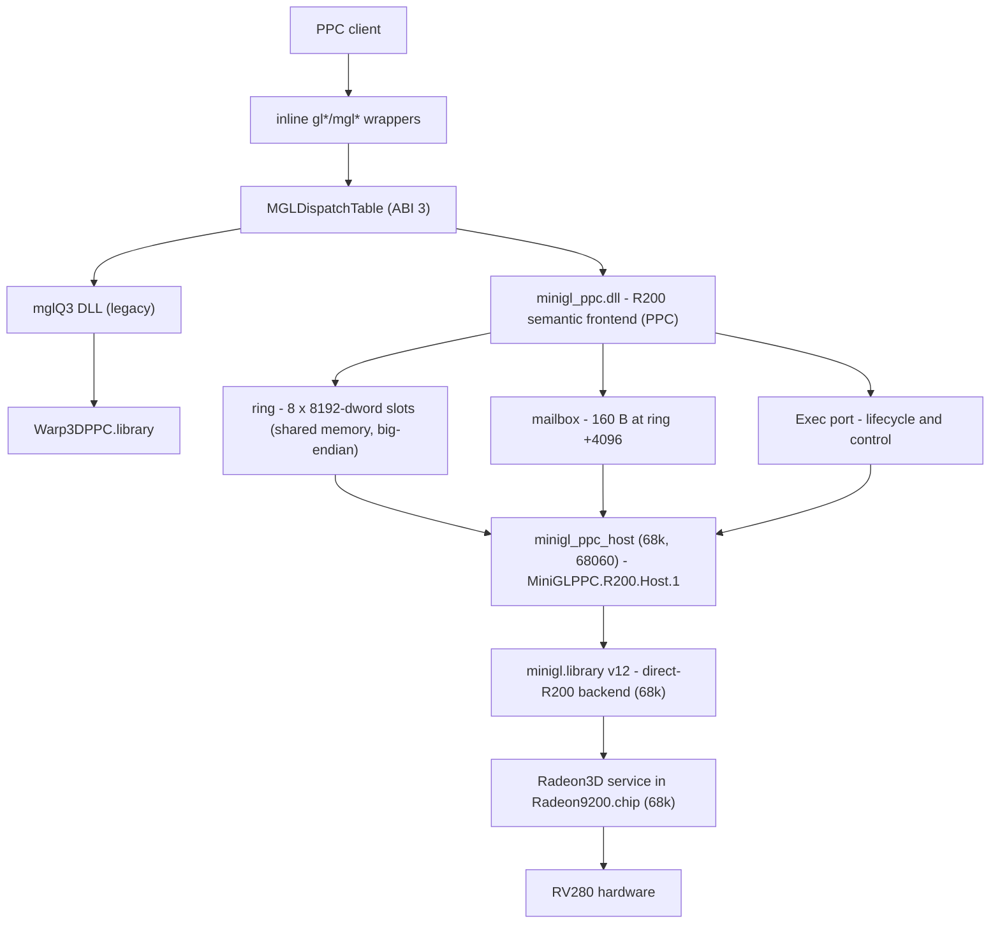

# Overview — what this library is and what this repo ships

## 1. What MiniGL is

MiniGL is a small OpenGL-1.x-style 3D API for Amiga systems. It exposes the
familiar `gl*`/`mgl*`/`glu*` call surface, a single *current context*, and a
positional **dispatch table** instead of ELF-free symbol resolution. Version 19
(`MINIGL_VERSION 19`, minimum accepted client `MINIGL_MIN_VERSION 10`) keeps the
released WarpOS **V10 dispatch prefix bit-exact** and appends new entries after
it; the dispatch ABI version is **3**.

MiniGL is not a driver. It is a GL frontend/validator that ultimately submits
rendering work to an Amiga 3D service. In this repository that service is the
**Radeon3D** API of `LIBS:Picasso96/Radeon9200.chip`, reachable only from 68k
code.

## 2. What this repository provides (PPC-first)

This repo builds the **WarpOS/PPC stack**: a PPC-side implementation of MiniGL
that runs on the PMC MPC7410 card and drives the Radeon 9200 through a 68k
helper task. Its primary product is the direct-R200 stack:

```
 minigl_ppc.dll      PPC  Hyperion-style DLL: R200 semantic frontend
 minigl_ppc_host     68k  service process on port MiniGLPPC.R200.Host.1
 minigl.library      68k  direct-R200 MiniGL backend (built in classic_68k tree)
 libminigl.a         PPC  client import archive (MiniGLOpen/MiniGLClose + loader)
```

The PPC side cannot execute raw 68k function pointers (that trips the WarpOS
"illegal run68k function execution" trap), but it *can* call 68k library
vectors and C functions through the `Run68K` bridge — measured at ~0.4–0.7 ms
per call, which is why the draw path does not use it (see
[run68k-direct-calls.md](run68k-direct-calls.md)). The design splits work by
ownership:

- **PPC DLL** owns all GL semantics: state tracking, matrix math, lighting,
  vertex transform/clip bookkeeping, texture bookkeeping, command generation.
  It never touches PCI, MMIO, the CP ring or VRAM.
- **68k host** owns the bridge to AmigaOS: it calls `minigl.library` /
  `Radeon3D.library`, which own the hardware. The host executes semantic
  batches, manages fences/present, and answers synchronous queries.

An alternate, legacy DLL build (`mglQ3`, built by `Makefile.dll.gcc`) implements
MiniGL on top of **Warp3D/Warp3DPPC**. It is not the R200 path and is not used
by the current hardware target; it is kept because it is the historical
backend and the source of the shared `mglQ3` GL core.

## 3. Two runtime paths at a glance

**Primary — direct R200 (what you should work on):**

```
 PPC client (libminigl.a)
   -> include/proto/minigl.h inline wrappers
   -> MGLDispatchTable (one pointer indirection, no 68k transition)
   -> minigl_ppc.dll  (backend_r200/library, PPC)
        semantic records + vertex payloads
   -> shared ring / mailbox / Exec messages
   -> minigl_ppc_host (68k)
   -> minigl.library direct-R200 backend (68k)
   -> Radeon3D.library service in Radeon9200.chip (68k)
   -> RV280 command processor / VRAM
```

**Legacy — mglQ3 over Warp3D:**

```
 PPC client -> same dispatch table -> minigl_ppc.dll (mglQ3 build)
   -> mglQ3/src -> Warp3DPPC.library -> installed Warp3D driver -> hardware
```

Both DLLs satisfy the same client-side contract (same ABI, same
`MGLGetDispatchTable` bootstrap), so a client linked against `libminigl.a` does
not care which DLL it loads — the DLL must simply be in its current directory.

End to end, including the legacy path:



## 4. Hardware target

| Component | Detail |
|---|---|
| Main CPU | Motorola 68060 (68k, big-endian), AmigaOS |
| PPC CPU | MPC7410 (PowerPC 604e-class, big-endian), WarpOS |
| PCI bridge | Prometheus |
| GPU | ATI Radeon 9200 (RV280), 64-bit DDR, PCI `1002:5964` |
| GPU services | `LIBS:Picasso96/Prometheus.card` (PCI/board owner) + `LIBS:Picasso96/Radeon9200.chip` (display, 2D, Radeon3D) |
| PPC runtime | WarpOS, `C:InitPPC` once per boot, `powerpc.library` |

Both CPUs are **big-endian**. The memory shared between them therefore needs no
byte swapping for protocol structures; swapping is confined to GPU-consumed
payloads (the RV280 command processor and little-endian surface formats), see
[architecture.md](architecture.md#7-endianness-and-alignment).

## 5. Repository map

| Path | Contents |
|---|---|
| `include/` | Public client API: `proto/minigl.h`, `libraries/minigl_dispatch.h` (ABI + wrappers), `libraries/minigl_fastpath.h`, dispatch-only `mgl/` |
| `client/` | `MiniGLOpen`/`MiniGLClose`, import-archive glue (`lib/libminigl.a`) |
| `hyperion_dll/` | Hyperion-style PPC DLL runtime (loader, startup, symbol/resource exports) |
| `ppc_dll/` | Positional dispatch-table initializers: real mglQ3, stub, R200 |
| `backend_r200/` | PPC DLL frontend (`library/`), transport client (`client/`), protocol headers (`include/`), 68k host (`minigl_ppc_host.c`), generated table, deep reference docs |
| `mglQ3/` | Shared legacy GL core used by the mglQ3 DLL and classic trees; talks to Warp3D |
| `Makefile.*.gcc`, `Makefile.wos.gcc.common`, `warpos-etrel.ld` | Build system (see [building.md](building.md)) |
| `classic_68k/` | The classic 68k V19 tree, owner of the 68k `minigl.library`; has its own `AGENTS.md` and docs |
| `examples/`, `tests/`, `tools/` | Client examples, C/Python test suites, dispatch generation and benchmark helpers |
| `bin/` | Build outputs; `bin/r200-package/` is produced by `make -f Makefile.dll.r200.gcc package` |
| `docs/` | This documentation |

## 6. Design rules that shape everything

1. **No per-call 68k↔PPC transitions.** A GL call is one indirect C call in the
   client's process; the PPC frontend batches and publishes asynchronously.
2. **Command submission is bounded and driver-owned.** The frontend emits
   semantic records into fixed-size slots; the driver service validates and
   owns the CP/MMIO/VRAM. Caps are negotiated at context creation.
3. **Resources are fixed and reused.** Two submit slots (8192 dwords each), an
   8-slot / 64 KiB ring, four vertex segments, an optional 256 KiB CP segment,
   ≤2 MiB staging buffers. No per-frame heap churn.
4. **The dispatch table is append-only.** Offsets through `GLPolygonOffset` are
   frozen at the V10 layout; the current table is `0x238` bytes.
5. **Everything is big-endian except GPU payloads**, which are swapped at the
   aperture boundary with `stwbrx`/`dcbf` (PPC) or word swaps (68k host).
6. **Diagnostics must not change timing.** Console output and trace loggers are
   opt-in and compiled out of release builds; benchmark runs leave them off.

## 7. Where to go next

- New developer: [architecture.md](architecture.md) then
  [client-guide.md](client-guide.md) to run something.
- Build/CI work: [building.md](building.md).
- ABI/API work: [dispatch-abi.md](dispatch-abi.md) — read the synchronization
  rules before touching the dispatch header.
- Protocol/host work: [transport-protocol.md](transport-protocol.md),
  [host-68k.md](host-68k.md).
- Performance work: [performance.md](performance.md), then
  [benchmarking.md](benchmarking.md) before touching the machine.
- Something is broken: [troubleshooting.md](troubleshooting.md).
