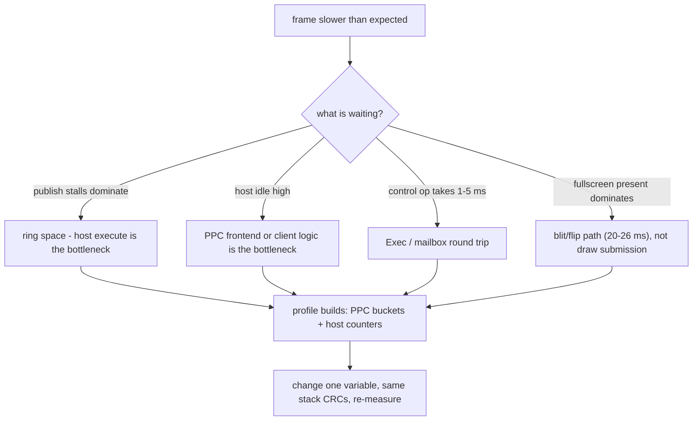

# Performance — measured numbers, budgets and cycles

This document collects the hardware-measured performance data for the PPC/R200
stack: FPS references, per-frame budgets, per-operation costs and cycle-level
figures where they exist. Read [benchmarking.md](benchmarking.md) before
producing new numbers and follow its protocol exactly.

## 1. How to read these numbers

**Measurement classes** (used throughout):

- **Measured** — read from a clock/counter on the physical machine.
- **Derived** — arithmetic on measured values, with the derivation shown.
- **Estimated** — not hardware-validated; never a gate.

**Hardware/software**: A4000 (68060), Prometheus, Radeon 9200 (RV280), PMC
MPC7410 WarpOS; `Radeon9200.chip` driver 3.x with Radeon3D interface 17–19
depending on build; MiniGL protocol 15. Unless a row says otherwise it is a
**single sample**, not a median.

**Clocks in play**:

| Clock | Typical value | Resolution / caveats |
|---|---|---|
| `DateStamp` (client wall) | 50 Hz ticks | ±2 ms/iteration on a 10-iteration loop; use ≥20 iterations for sub-5 ms claims |
| EClock | 709379 Hz (session value) | used by host/pacing; wraps in ~6055 s |
| PPC timebase (`mftb`) | 24.665830 MHz (yield session), 24.74 MHz (profile session), ~25.0 MHz (U0) | per-boot calibration; **always re-read**, never assume; 32-bit wrap ~172 s at 25 MHz |
| driver `R3DEXEC` phase timers | microseconds | driver-internal copy/build/submit breakdown |

`PerfClock` on PPC uses `mftb` with an initial `Delay(2)` calibration; the
whole-run DateStamp comparison is the authoritative calibration. The old
`Delay(2)`-only calibration read 26.9–36.4 MHz (≈34.6 MHz typical) and is
historically **untrusted**. `%llu` is unsupported on this toolchain: print
hi/lo hex or `%lu`.

**Never mix** profile-build and quiet-build numbers, different boot states, or
different DLL/host pairs in one comparison. Profiler overhead itself was
measured at ~5% (gears quiet 135.1 → profiled 129.9; room-walk 12.0 → 11.8).

## 2. Reference workloads and current best-known numbers

| Workload | Configuration | FPS | Conditions |
|---|---|---:|---|
| Precalc gears | FS 640x480x16, 3 buffers, BLIT, sync off, `-frames 600` | **144.927** | current-source rebuild, warm boot (2026-09-17) |
| Precalc gears (prior stack) | same | 134.529–136.363 | validated sessions; the old gates |
| Gears (non-precalc) | FS 640x480x16 | ~135 | older stack |
| Windowed CP-emitter gears | 800x600x32, CP emitter, sync off | **68.337–69.444** | validated; 2031 IBs / 511620 dwords / 600 presents |
| Fullscreen CP-emitter gears | 640x480x16 | 174.418 (single-fence) / **182.926** (pipelined) | 3-run medians; semantic reference 133.928 → +30% / +37% (historical) |
| Fullscreen CP-emitter gears, driver 0.41 | 640x480x16, 3 buffers, BLIT, sync off, `-frames 600`, `MGLPPC_NOALTIVEC=1`, `MGLPPC_HOSTPRI=-1` | 189.873 / 191.082 / 193.548, median **191.082** | 2026-10-20, one warm boot (bridge reboot), `InitPPC` once; chip 0.41 `D6C49D32` / card `31D230C4`; warpelf `C07A8319`, DLL `16CB8018`, host `0010B189` (`MGLPPC_HOST_DBG=0`), minigl.library `1680AD09`, client `1F3401F7`; every run error=0, 2031 dispatches / 511620 dwords / 600 presents. Built from a dirty worktree (uncommitted frontend work); same band as the 0.40-era 188.7–196.1 cold-boot series |
| PPC engine lease, gears (opt-in) | same as the 0.41 row, `MGLPPC_LEASE=1` | **84.269** (single run) | 2026-10-20, same boot: before this change 14.7 (doc'd stress) / emit failure on precalc; progression 143.5 (C1, bounded fallback) -> 21.1 (vblank flip: sync state not published) -> 48.9 -> 52.8 -> 84.3 (lease via mailbox). Per frame: LEASE_END ~3.7 ms, fence waits ~2.4 ms, resume ~1.3 ms, LEASE_BEGIN ~0.4 ms. Still below the bounded path; not a benchmark configuration |
| Same stack, bounded (no lease) | 0.41 row conditions | 189.873 / 189.873 / 187.500, median **189.873** | 2026-10-20 regression check of this change (dirty worktree, DLL from warpelf `C4B5A563`, host `08A74548`): unchanged within noise |
| Silent Hill intro | fullscreen, `--frames 300` | **63.829** | current-source rebuild; stale pair measured 20.4–22.4 |
| Texture upload suite | fullscreen, `--frames 300` | **44.642** | current-source rebuild; stale pair 19.4 |
| Quake room walk | 800x600x32 | **59.405** | current-source rebuild, nosync, bind-deferral era; was 12.0 before bind deferral (4.9x) |
| Alias ogre (single) | windowed suite | 142.9–150 | 1000 000 fps_x1000 ceiling reported by suite |
| Lightmap update | suite | ~14.4 (nosync) | its own `glTexImage` dominates the frame |

**Status note (2026-09).** The 2026-09-17 handover records that the old
benchmark gates (25.167 / 20.9 / 134.5–138.2) are **obsolete** and that a
cold-boot three-run median series for the current source stack had not yet
been run. Treat the bold numbers above as the best-known current-source values
(warm boot) until a cold-boot series replaces them; record every new series
here with its conditions.

### 2.0 The ~190 FPS milestone `gears_p4` series (2026-09-26) — and its 2.5x regression

The milestone client `gears_p4` (built from
`examples/milestone_gears_stats_library.c`, reporting `GEARS_RUN`; it is **not**
the canonical `gears_benchmark.c` client, so per [benchmarking.md](benchmarking.md)
these numbers are not a canonical A/B) was run fullscreen 640x480x16, three
buffers, sync off, `-frames 600 -width 640 -height 480 -depth 16 -buffers 3
-nosync -nofps`, on the physical A4000 68060 / MPC7410 / RV280.

| Build | Client | Library | Host | Sample(s) | Conditions |
|---|---|---|---|---:|---|
| dirty PPC frontend | `gears_p4` `92597327` | `CDF4451B` | `EB52F5CB` | **76.726** | cold boot, `error=0`, `dispatches=2031 dwords=511620 presents=600` |
| clean `13e3dba` PPC frontend | `gears_p4` `92597327` | `CDF4451B` | `E8C6568F` | **196.078** / **189.873** | two independent cold boots, `error=0`, same `dispatches=2031 dwords=511620` |
| fixes `fix/r200-frontend-correctness` | `gears_p4` `92597327` | `CDF4451B` | `E8C6568F` | **192.307** / **188.679** | two protocol cold boots, `error=0`, same `dispatches=2031 dwords=511620` |

The fixes row is the salvaged change set (locked-array live colour/texcoords,
lit-only compact TCL stride, `PerfClockDeltaMs`, protocol comment
corrections) cross-built from a pristine worktree; converted DLL CRC32
`05FA4903`. It sits inside the clean-reference band, so none of the fixes
cost measurable host-path throughput. Two additional samples of the same
build measured **111.111** and **111.940** — both were launched in the same
AmigaDOS script, seconds after `C:InitPPC`; identical host counters
(`dispatches=2031 dwords=511620 presents=600`, `priority=-1`) rule out
rendering and host-configuration causes. The compressed-launch hazard is
reproducible; see [benchmarking.md](benchmarking.md) section 7.2.

Hardware-validated 2026-09-26 alongside the benchmark: the 31-case
`minigl_testsuite` regression run against this build passed 29 cases
(including all texture, lightmap, alias-ogre and present-stability cases);
`lighting.availability` skipped (`lighting vectors unavailable`), and the
single `quake.world-room-walk` failure is the known broken validator
([testing.md](testing.md)): the clean reference DLL reproduces the identical
pixel mismatch and the operator confirmed the on-screen rendering.

**Measured cause: debug file loggers in the PPC hot path.** The rendered work
was byte-identical across both builds — same `dispatches=2031`,
`dwords=511620`, `presents=600` — so the 2.55x difference was entirely
CPU-side overhead, not less rendering. Uncommitted edits in
`backend_r200/library/r200_surface.c` (`R200ClearLog`, an `Open`/`Seek`/
`Write`/`Close` cycle on `DH2:cleardbg.log` **per `glClear`**) and
`backend_r200/library/r200_geometry.c` (`R200RecStateLog`, the same per batch
on `DH2:recstate.log`, plus a `vsnprintf` with eight `double` arguments) are
compiled into the PPC DLL through `backend_r200/library/r200_unity.c` ->
`r200_frontend.o`, so they run in the frontend's hottest loops. The 400/200
line caps were reached and the files were written on hardware
(`DH2:recstate.log` 134,523 bytes, `DH2:cleardbg.log` 11,400 bytes; retained
under `evidence/perf-regression-20260926/`). The clean DLL left both files
untouched and measured 2.55x faster.

Note that `backend_r200/library/r200_*.c` and
`classic_68k/dev/MiniGL_Library_Source_Code/library/r200_*.c` are **separate
copies** with the same names. The 68k `minigl.library` is built from the
classic tree (its CRC was `CDF4451B` both dirty and clean, which is what
isolated the fault to the PPC DLL); the PPC DLL is built from
`backend_r200/library/`. Editing the wrong copy silently changes nothing.

**Rules this establishes:**

- A bounded counter does **not** make hot-path file I/O safe. `recStateLogs <
  400` still costs hundreds of file operations inside a 600-frame run, and it
  makes the cost data-dependent on run length.
- Per-frame `glClear`/draw logging must be compiled out or env-gated, in the
  same class as `MGLPPC_CLIENT_TRACE`, `MGLPPC_HOST_TRACE` and
  `MGLPPC_UPLOAD_TRACE`. A new on-target log path is never an acceptable
  quiet-build default.
- When a number collapses, check the **converted artifact's** provenance
  before optimising code. Rebuild the stack from a pristine worktree
  (`git worktree add --detach <dir> HEAD`) and compare identical workloads;
  equal `dispatches`/`dwords`/`presents` across builds means the delta is
  overhead, not rendering.
- Never mix a dirty-worktree artifact into a stack whose number is quoted.
  Record the artifact CRC32, and remember only CRC identifies a build.

The local work that carried the regression is parked, unmerged, on
`local/dirty-perf-regression-2026-09-26` (`cae45a0`); it also contains the
host-less stack, which is uncommitted work and therefore **cannot** be built
from `main` (`Makefile.dll.r200.hostless.gcc` and the
`backend_r200/library/r200_hostless_*.c` sources are untracked there).

### 2.1 Hygiene matrix (640x480x32, 150 frames, envmap, one cold boot)

| Configuration | FPS | Ticks |
|---|---:|---:|
| FS BLIT, nosync, precalc / normal | 19.531 / 19.531 | 384 / 384 |
| FS BLIT, sync, normal / precalc | 18.750 / 18.939 | 400 / 396 |
| FS FLIP, sync, normal / precalc | 16.703 / 16.163 | 449 / 464 |
| Windowed BLIT, normal / precalc | 20.215 / 19.946 | 371 / 376 |

All rows: `executes=508 presents=150 error=0`. These are single-run hygiene
references for isolation experiments, not headline numbers.

### 2.2 Host priority and scheduling

| Test | FPS |
|---|---:|
| Fullscreen, host priority 0 | 19.430 |
| Fullscreen, host priority -1 | **41.666–41.899** |
| Windowed, host priority -1 | 41.666 |
| FLIP + sync, priority -1 | 20.7–20.8 |
| Six reboot-isolated trials | median 19.230 @0 vs 42.134 @-1 — **2.19x** |

`MGLPPC_HOSTPRI` is an environment variable; a reboot clears it. Verify it
before a benchmark session — an unset priority roughly halves throughput.

## 3. Frame budgets

### 3.1 PPC frontend, semantic vs CP (gears, profiled)

| Bucket | Semantic | CP emitter |
|---|---:|---:|
| serialize (ticks / ms per frame) | 27,396,264 / 1.847 | 27,274,044 / 1.848 |
| execute | 3.42 ms/f | 2.15 ms/f |
| present | 1.02 ms/f | 0.59 ms/f |
| quiet FPS reference | ~133.9 (specced elsewhere) | 178.571 |

Per 600 frames: 1,656,000 vertices, 15,000 draw records, 2031 submissions,
`kernel_flushes=15000` (25/frame), 110 vertices per flush.

### 3.2 Publish path (640x480x32, fullscreen, 600 frames, profiled ~56 FPS)

| Metric | Value |
|---|---:|
| publish wait per frame | 12.64–13.31 ms |
| ring-space wait portion | 12.59–13.26 ms (**99.6%**) |
| non-wait publish cost | 0.050 ms |
| present-queue wait (`barrierStallTicks`) | 1.55–1.70 ms/f |
| frontend total | 2.50 ms/f |
| serialization (nested) | 1.99 ms/f |
| PublishCount | 2631 (2031 renders + 600 presents) |

The frontend was **idle-waiting on ring space** in 99.6% of publish time:
production was faster than host consumption. Do not optimize publish
bookkeeping before checking ring occupancy.

### 3.3 Frame split at ~59 FPS (800x600x32 windowed, Serialization_profile)

PPC frame 16.9 ms: scene 11.5, frontend 10.2, serialization 9.34 of which
**80.8% is ring stall** (true CPU 1.807 ms), display switch 5.35–5.43.
68k host frame 16.96 ms: submit-fence wait 7.9, submit/build 3.4,
present-fence 1.49, blit 3.16–3.18. The serializer was bus-bound at ~61 MB/s
for 110 KiB/frame, not instruction-bound.

### 3.4 68k host loop (room walk vs gears, profiled)

| Metric | Room walk | Gears |
|---|---:|---:|
| PPC publishes/frame | 4.4 | 14.1 |
| 68k executes/frame | 3.4 | 13.1 |
| PPC_CONTROL calls/frame | 0.01 | 33.2 |
| PPC_YIELD/frame | 0.06 | 11.2 |
| per-execute | 2.2 ms | 3.4 ms |
| per-mailbox | ~0.5 ms (3 msgs) | 5.8 ms avg |
| host busy | 34% | ~90% |

`PPC_CONTROL` consumed 95% of a 925.4M-tick lifetime in the gears case;
publish stalls totalled 93,906 ticks. Room walk was present/driver-bound;
gears was control-round-trip-bound.

### 3.5 Host profile (fullscreen, 2 buffers, ms/frame)

| Bucket | ms/frame |
|---|---:|
| ring | 15.60 |
| Radeon3D | 9.36 |
| bridge | 0.46 |
| retire wait | 1.20 |
| fence drain | 0.43 |
| present | 2.83 (native counter 2.64) |

### 3.6 Classic-68k library budget (context for the host side)

Measured 186.95 ms frame (5.349 FPS) on the classic R200 path, before
optimization batches: app math 34.97, API 22.87, frontend 40.54
(serialization 12.43 included), Execute 55.53, present 25.44, other 7.60.
Driver Execute split (600 submits, 100 frames, FS 640x480x32 envmap):

| Phase | per call | ms/frame | share |
|---|---:|---:|---:|
| copy | 1540 µs | 9.2 | 17% |
| build | 3385 µs | 20.3 | 36% |
| submit | 4505 µs | 27.0 | 49% |

After burst stores/unrolling/compaction: library Execute 55.5 → 48.7 ms/frame,
driver build 17.7 → 16.45 ms/frame, submit 27.0 → 23.5 ms/frame (−13.9%).

## 4. Per-operation costs

### 4.1 Submission and driver calls

| Operation | Cost |
|---|---:|
| host submit call (68k→driver) | 1.15 ms/call |
| driver internal submit | ~82 µs (copy 11.5 + build 46.0 + submit 24.6) |
| per-execute (host) | 2.2–3.4 ms |
| present, windowed 32-bit | 2–3.3 ms |
| present, fullscreen BLIT | 20–26 ms |
| present, FLIP | native 24.9 ms/frame; `ChangeScreenBuffer` 22–27 ms/call (notification wait 0.1407 ms/call) |
| 16-bit **windowed** present | ~180 ms/frame (9x the 32-bit tick count; per-pixel ClipBlit conversion) |

The 16-bit windowed path is a known-slow corner: Workbench is 32-bit, so P96
converts every pixel. Never use it as a throughput target.

### 4.2 Control round trips

| Operation | Cost |
|---|---:|
| Exec control operation | ~1–5 ms each |
| mailbox poll loop | ~1 poll / 100 µs, timebase-only |
| mapping benchmark throughput | ~80 MB/s (identical for geometry and P96 texture mapping) |
| 32 x `glTexImage` (pre-mailbox) | 5.9 s wall while the host handled 137 commands in 272 ms |

### 4.3 Cache maintenance

- PPC publish: `dcbf` per modified line + `sync`; the per-frame flush volume
  (~120 KB) made a naive commit-streaming design a **24% regression**
  (2.514 vs 3.290) — the "17x aperture" probe only applies to tight loops.
- 68k receive: `CacheClearE` per publish/segment; PRESENT-only entries must
  skip data-cache work, CRC checks and Execute.
- Texture direct surfaces: `CacheClearE` on the leased surface
  (`r200_texture.c`).
- 64 KiB residency rebuild copy-back: ~11 ms (`CopyMem` ~5.8 MB/s through the
  aperture).

### 4.4 Direct PPC→68k calls (`Run68K`)

Measured 2026-09-22 on a fresh boot (no host running, `minigl.library` v12,
`powerpc.library` 17.15), 1000 iterations, per-run timebase calibration
(24.4–24.9 MHz); full context in
[run68k-direct-calls.md](run68k-direct-calls.md).

| Call | ns/call |
|---|---:|
| `exec FindTask(NULL)` via `Run68K` (register ABI) | 405,000–413,000 |
| same via the SDK LP stub (control) | 400,000–409,000 |
| `dos DateStamp(&buf)` via `Run68K` | 932,000–941,000 |
| `minigl.library` LVO −30 (dispatch table) | 402,000–405,000 |
| `mglChooseWindowMode` via `PP_Stack` | 674,000–679,000 |
| Exec `PutMsg`+`WaitPort`+`GetMsg` loopback | 1,500,000–1,522,000 |
| `GLGetString(ctx, …)` via dispatch entry | 628,000–675,000 |
| `GLClear(ctx, color\|depth)` via dispatch entry | 950,000–1,055,000 |

Reference: ring publish with no OS calls is **82–94 µs**. Direct calls are
therefore 4–8× more expensive and lose the PPC/68k overlap; they are only
attractive for init/control operations, not for per-draw or per-GL-call
work.

## 5. Cycle-level data

These are the only cycle-level figures the project has measured. Do not
extrapolate them to other operations without a measurement.

| Datum | Value | Kind | Derivation / condition |
|---|---:|---|---|
| Aperture store model | **~27 CPU cycles / 4-byte store** | derived | 1.85 ms per frame for 27,600 stores → 67.0 ns/store; 7410-class core clock (TB-calibrated session) |
| PPC serialization, vector vs scalar | **−14.0% / −16.1% / −15.3%** serialize ticks | measured | 3-run medians across semantic/CP/room-walk; vector 23.69M vs scalar 27.41M ticks (gears semantic) |
| AltiVec serialization end-to-end | semantic **+10.4%**, CP **+25.0%** FPS | measured | medians of 3 boots; vector checked byte-identical (CRC `FFED5264`) |
| `FloatBits` inline vs out-of-line | ~24,000 calls/frame difference | measured | out-of-line call count observed in a profile build |
| 68k trusted-copy floor | **~11.6 cycles/dword** | derived | eight-wide register unroll, "effectively at its floor" |
| 68k submit staging | **~0.79 µs/dword ≈ 6 MB/s** | measured | per-dword `CpStreamDword` + swap + volatile aperture store; burst-store fix then staged 8 swapped longwords with a `movem` pair |
| 68060 misaligned FP store trap | **4.47 µs vs 0.04 µs aligned** | measured | `lfs/stfs` at offset%4==2 on 7410/PowerPC; same class of trap cost 84 µs/vertex in an early PPC build until fields were widened/padded (0.29 µs/vertex after) |
| `WaitTime(0,100)` | **~20.305 ms/call** (198 calls / 99,165,482 ticks @24,665,830 Hz) | measured | DOS delay quantization; `Delay(1)` is a 50 Hz tick |
| Bounded-poll fix | yields 198 → 33 per 600 frames; 59.760 → 102.040 FPS | measured | 131,072-iteration poll budget before yielding |
| Host misclassification (PPC bits) | 67.774 vs **140.752 FPS** (401 MB/s vs 22 MB/s `mapping_bench` under trace) | measured | same binary, different LoadSeg classification |
| Unity vs split frontend (68060) | 5.77 → 5.39 FPS (**~6%**) | measured | per-module objects lose cross-module inlining; unity restores 5.797/5.788 |
| Fullscreen state-batch expansion | estimate 10,176 → bound 982 → actual **722 dwords** | measured | unlit textured 64-draw, no depth; wire limit 8192 |
| Serializer bus rate | ~61 MB/s (110 KiB/frame, bus-bound) | measured | PPC serializer residual CPU 1.807 ms unchanged by kernel work |

## 6. Transport and batching costs

### 6.1 Mailbox impact (texture workload, 8 frames / 32 tiles)

| Configuration | Throughput |
|---|---:|
| Mailbox off, old control path | ~710,070 B/s (11.2 s) |
| Mailbox on | 1,246,088 B/s (3.8 s) |
| Mailbox on, console/allocation noise removed | **15,744,776 B/s** (0.53 s) |
| FS stress (120 frames / 480 uploads) | 15,192,512 B/s |

Routing changed from 137 Exec messages to 8 Exec + 129 mailbox requests;
mailbox handler time 61,105 µs. The remaining gap was diagnostic console
output, not the protocol.

### 6.2 Host target-surface cache

V2 surface queries 2032 → 746 with 1286 hits (−63.3%); EClock 212,271 →
105,133 ticks = 0.499 → 0.247 ms/frame at 709,379 Hz. FPS was unchanged
(56.390/56.390) because the workload was bound elsewhere — a good example of a
real cost reduction with no FPS effect.

### 6.3 Batching limits

| Limit | Value | Notes |
|---|---:|---|
| Record dwords | 8192 (`RADEON3D_MAX_BATCH_DWORDS`) | 16384 was tested: no gain, more noise |
| Draws per slot | 192 | not a limit at 25 records/frame |
| Submit slots | 2 | one filling, one in flight |
| Ring slots | 8 x 8192 dwords | reuse after `retired` |
| CP slices | 8 x 32 KiB (256 KiB segment) | reuse after `retired` |
| State-batch mismatch threshold | 4 (`MGLPPC_EXPAND_MIN`) | gears-tuned |
| Texture staging | ≤2 MiB, 64 KiB Exec chunk | 16000 words |

Batching pitfalls measured:

- Unconditional state-batch expansion raised room-walk to 31.7 FPS but dropped
  gears to **91.2 FPS** — rejected in favour of the mismatch threshold.
- Full 44-dword record headers regressed gears; compact records won.
- Batched two-tile upload: 15.7 ms BEGIN2 vs 2.1 ms BEGIN, write 1.4 vs 2.7,
  COMMIT 0.6 vs 2.0, barrier 3.0–3.7 ms, host handler 1.5 vs 2.8 ms. The
  missing ~13 ms is deferred-service latency (immediate BEGIN answers in
  ~0.6 ms) → net regression, opt-in only.

## 7. Texture costs

Full tables live in [textures.md](textures.md). Headline figures:

- Direct upload per call improved **24.35 ms → 11.27 ms** (barrier 6.09 → 2.60,
  write 5.83 → 3.55, shadow 6.89 → 0).
- `TexSubImage` 256: 408–415 ms → 130 ms; final windowed set 3–15 ms per
  operation.
- One 64 KiB residency rebuild ≈ 12 ms (0.8 alloc + 0.2 import + 11 copy-back).

## 8. Regression catalogue

Every row was measured; use this as a checklist when a run looks wrong.

| Symptom | Factor / value | Root cause |
|---|---|---|
| ~0.48x throughput | 67.774 vs 140.752 FPS | 68k host loaded as PPC (Sonnet classifier; `RACE` literal) |
| ~0.5x throughput | 19.4 vs 41.9 FPS | `MGLPPC_HOSTPRI` unset after reboot |
| 7.8 FPS, `presents=0` | deterministic | DLL and host from different builds |
| 20–22 vs 63.6 FPS | deterministic | stale deployed pair vs current source |
| −35% | 59.760 → 102.040 FPS | `Delay(1)`/`WaitTime` parked waits |
| large | 0.880 FPS | 68k `gears` binary mistakenly compared as PPC evidence |
| ~3 FPS | 16-bit windowed | P96 per-pixel conversion |
| −24% | 2.514 vs 3.290 | per-frame `dcbf` commit streaming over-flush |
| gears 91.2 FPS | from ~135 | unconditional batch expansion |
| intro 29.3–29.6 FPS | from 62–66 | `MGLPPC_BATCH=1` two-tile deferral |
| 11.5 s/frame | overlay | RastPort overlay rendering |
| ~14.1% serialize ticks | (gain) | encoder/movem improvements |
| −6% | 5.39 vs 5.77 FPS | split objects instead of unity |

## 9. Profiling tooling

| Tool | Build/run | Output |
|---|---|---|
| PPC frontend profiler | `MGLPPC_PROFILE=1 OBJDIR=obj/dll-r200-prof WARPELF=bin/minigl_ppc_r200_prof.warpelf` | buckets (control, texture, barrier, publish, yield) to `DH2:mglprof/dll-profile.log` at destroy |
| 68k host profiler | `MGLPPC_PROFILE=1 R200_HOST=bin/minigl_ppc_host_prof make … host` | shutdown counters: control/barrier/mailbox/ring ticks, uploads, `HOST_SUBIMAGE` handler/preflight/native/bridge |
| `MGLPPC_PACING=1` | host build | EClock present-interval histogram + 16 longest gaps |
| `CP_PROF` | host build | fence/dispatch and CP-entry timings; `CP_RUN dispatches/dwords/failed` at shutdown |
| `MGLPPC_BATCHDIAG` | profile DLL | `PerfClock` batch diagnostics to `DH2:wosbuild/batchdiag.txt` |
| frame-260 deep profiler | test build | 128-event phases (`PPC_LM`/`HOST_LM`), nested — do not sum |
| `GEARS_RUN` | any client with `-frames N` | console-independent `frames=... fps=...` summary |

**Attribution rules**: profile builds change timing (~5%), run from dedicated
directories (the client loads the DLL from its CWD), and profile numbers must
never be compared against quiet numbers. For sub-5 ms claims use ≥20 DateStamp
iterations. Never run diagnostics (`MGLPPC_VERBOSE`, traces, pacing) in a
quiet measurement.

Attribution guide before touching code:

## 10. Keeping this document current

When a change affects performance, add or update a row **with**: the measured
value, unit, method, configuration (mode/depth/buffers/sync), stack identity
(commit + CRC pair), boot state (cold/warm), and whether it is measured,
derived or estimated. Delete or mark superseded numbers instead of leaving two
incompatible values. Never copy a number from another stack or session without
its conditions.
