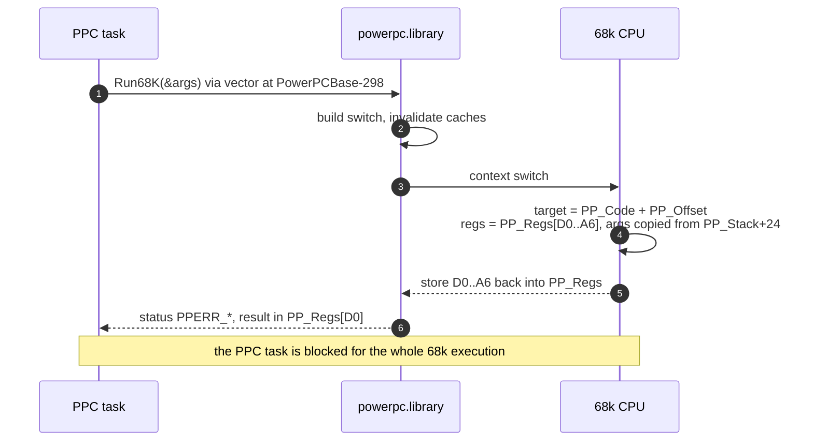
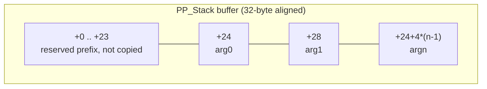

# Direct PPC→68k calls (`Run68K`) — measurements and constraints

This document records the 2026-09-22 hardware experiments that answered a
long-standing question: **can a native PPC WarpOS application call the 68k
`minigl.library` (and its dispatch table) directly, without the
`minigl_ppc_host` process?** And if so, what does it cost?

Short answer: **yes, it works**, including creating, querying, drawing into,
presenting and deleting a real MiniGL context. It is **not cheaper than the
ring for the draw path** (~0.4–0.7 ms per call versus ~82–94 µs per ring
publish), so the host/ring design stays for geometry; direct calls are
viable for init/control operations.

## 1. Probes

Two staged applications, built by `Makefile.import.gcc` and run on the
physical A4000 (68060 + MPC7410, Prometheus + Radeon 9200, WarpOS
`powerpc.library` 17.15, 68k `minigl.library` v12, no host running):

| Probe | Purpose |
|---|---|
| `examples/r200_run68k_bridge_probe.c` | bridge sanity, LVO calls, dispatch entries, timing matrix |
| `examples/r200_run68k_context_probe.c` | create/query/clear/draw/present/delete a real 68k context |

Build and deploy:

```sh
make -f Makefile.import.gcc bin/examples/r200_run68k_bridge_probe_ppc.warpelf \
                              bin/examples/r200_run68k_context_probe_ppc.warpelf
# zip/push, UnZip on the Amiga, then:
Elf2Exe2 r68bridge.elf r68bridge
Elf2Exe2 r68ctx.elf r68ctx
r68bridge                 # bridge + timing; no MiniGL host needed
r68ctx -nopresent         # context without present
r68ctx -hold 30           # full run; holds the window for screenshots
```

Crash-durable traces (open/append/close per line):
`Work:wosbuild/run68k_trace.log`, `run68k_result.txt`,
`run68k_ctx_trace.log`, `run68k_ctx_result.txt`.

## 2. The mechanism

`Run68K` is a PPC-side vector of `powerpc.library` at LVO −300. The MOS2WOS
LP stubs call it internally; the probes replicate exactly that sequence
(read the target pointer at `PowerPCBase−298`, call with `r3=PowerPCBase`,
`r4=&PPCArgs`). `PowerPCBase` is set by `startupwos.o` in `__start`.

`struct PPCArgs` (`powerpc/powerpc.h`) supports both 68k calling
conventions:

- **Library vectors (register ABI):** `PP_Code = library base`,
  `PP_Offset = LVO` (negative), `A6 = library base`, arguments in
  `PP_Regs[D0..A6]` (`PPREG_*`). Return value in `PP_Regs[D0]`; `Run68K`'s
  own return is the `PPERR_*` status.
- **Plain C functions (stack ABI)** — the MiniGL dispatch table entries:
  `PP_Code = entry`, `PP_Offset = 0`, `PP_Stack`/`PP_StackSize` carry the
  arguments.

Call flow (synchronous on both sides):



### 2.1 `PP_Stack` needs the 24-byte prefix

The WarpUP 68k-side handler (`Runk86` in the SonnetAmiga `powerpc.s` source)
copies `PP_StackSize` bytes from **`PP_Stack + 24`** onto the 68k stack:
*"Offset into stack must be 24 (see docs Run68K)"*. The prefix is mandatory
and not copied. Arguments are laid out first-argument-first (`argv[0]` ends
up at `4(sp)`, i.e. `8(a5)` after `link`). Getting this wrong made every
stack-ABI call receive zeros; `mglCreateContext` then returned NULL.

Argument block memory layout expected by the kernel:



### 2.2 Float arguments are on the stack

`Lib_glVertex4f` loads its float arguments from the argument stack
(`fsmove.s (a0)+`), so no `PP_FRegs` setup is needed for GL calls: pass the
IEEE-754 bit patterns as ordinary stack longwords.

## 3. Measured cost (physical machine)

Fresh boot, `C:InitPPC` once, no host, 1000 iterations (context timing:
200), timebase calibrated per run (24.4–24.9 MHz).

| Call | ns/call | Notes |
|---|---:|---|
| empty PPC loop | ~13 | reference |
| `exec FindTask(NULL)` via `Run68K` (register ABI) | **405,000–413,000** | ~0.41 ms |
| same via SDK LP stub (control) | 400,000–409,000 | identical mechanism |
| `dos DateStamp(&buf)` via `Run68K` | **932,000–941,000** | includes memory write-back/cache |
| `minigl.library` LVO −30 (dispatch table) | **402,000–405,000** | same cost as any no-stack LVO |
| `mglChooseWindowMode(TRUE)` via `PP_Stack` | **674,000–679,000** | one stack argument |
| Exec loopback `PutMsg+WaitPort+GetMsg` | **1,500,000–1,522,000** | three bridged calls |
| `GLGetString(ctx, …)` via dispatch entry | **628,000–675,000** | context probe |
| `GLClear(ctx, color\|depth)` via dispatch entry | **950,000–1,055,000** | real render submission |

These are **4–8× more expensive than the ring publish** (~82–94 µs, no OS
calls) and comparable to the mailbox control operations (0.3–0.6 ms). The
kernel flushes/invalidates caches per switch, which is why even small calls
cost hundreds of microseconds; a call with memory write-back is ~2× a
register-only call.

## 4. What the probes proved

`r68bridge` (failures=0):

- `OpenLibrary("minigl.library", 10)` works from PPC (v12.0 opened).
- `Run68K` into exec/dos LVOs and into the third-party `minigl.library` LVO
  works; results match the LP-stub path.
- The dispatch table is returned: **ABI 5, structSize 628 (0x274), flags 8**,
  table address only 2-byte aligned (legal 68k ABI) — read it byte-wise from
  PPC, not with 32-bit loads.
- Stack-ABI dispatch entries (`mglChooseWindowMode`, `mglChoosePixelDepth`,
  `mglChooseNumberOfBuffers`, `mglChooseVertexBufferSize`) execute.

`r68ctx` (failures=0, `-nopresent` and full):

- `mglCreateContext(0, 0, 320, 240)` returns a valid context, and the
  library logs `[mgl] ctx fullscreen=0 depth=16 mode=0`; a real
  `MiniGL_R200` window appears on Workbench.
- `GLGetString` returns `MiniGL_R200` / `1.1 MiniGL_R200 phase6` /
  `Radeon3D semantic R200` / `GL_ARB_multitexture GL_MGL_performance_counters`.
- `GLClear`, `GLBegin`/`GLColor4f`/`GLVertex4f`/`GLEnd`, `GLFinish`,
  `MGLSwitchDisplay`, `MGLDeleteContext` all execute with `status=0` and
  `GLGetError=0`.
- The presented window showed a black client area in this probe; pixel-level
  verification of the direct draw path is an open follow-up (the draw
  parameters and present sequencing were not validated against the 68k
  client wrapper's behaviour).

## 5. Library-specific gotchas found

1. **The backend has its own enum numbering** (`library/minigl_r200.h`), not
   standard GL: `GL_VENDOR=205`, `GL_VERSION=206`, `GL_RENDERER=148`,
   `GL_EXTENSIONS=57`, `GL_TRIANGLES=191`,
   `GL_COLOR_BUFFER_BIT=0x1`, `GL_DEPTH_BUFFER_BIT=0x2`. Passing standard GL
   values returns `GL_INVALID_ENUM` (88).
2. **Raw dispatch entries do not set `*currentContext`.** The client wrapper
   in `include/libraries/minigl_dispatch.h` publishes the context after
   `mglCreateContext`; a direct consumer must do the same if it relies on
   the global. GL entries themselves use the context argument.
3. **`WaitFor68K` after a synchronous `Run68K` wedges the task** (run #1
   hung until a reboot; it does not return `PPERR_WAITERR`). Async Run68K is
   not supported by this `powerpc.library` (see the GLQuake sound note), so
   `WaitFor68K` must not be used in a sync-only design.
4. **Every direct call is synchronous**: the PPC task blocks for the whole
   68k execution, so a host-less design loses the PPC/68k overlap the ring
   provides.
5. A timeout/wedge in a direct call cannot be broken from software
   (`Break`, `Kill` ignored); it needs a cold reboot, exactly like a wedged
   host client.

## 6. Consequences for the architecture

- **Do not replace the ring for draw submission.** 0.4–0.7 ms per call
  versus one 82–94 µs publish (and the host work overlaps the PPC frame);
  ~2800 GL calls/frame in Quake-class clients make per-call crossing
  impossible.
- **Direct calls are attractive for low-frequency control**: context
  creation/deletion, chooser setup, `glGetString`, `glFinish`, present, and
  possibly the mailbox-whitelisted texture/readback operations. A hybrid
  could remove mailbox/Exec latency for those paths without touching the
  draw pipeline.
- **A host-less design is technically possible** (the context probe ran the
  whole lifecycle from the PPC task), but it would need: 68k-ABI struct
  mirrors for any pointer-passed structure, explicit cache discipline,
  present/input ownership, and acceptance of synchronous execution and
  cold-reboot recovery.
- **The old claim "PPC code cannot call that 68k library directly" is
  wrong as stated.** PPC cannot execute a raw 68k function pointer (it
  traps); it can call 68k code through `Run68K`, which is a real, supported
  mechanism. The reason the host exists is batching, overlap, isolation and
  lifecycle, not an inability to call.
