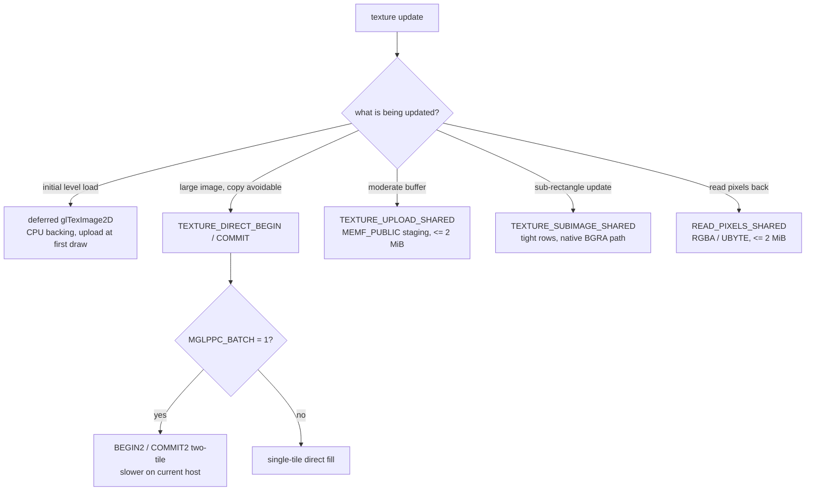

# Textures — paths, formats, residency and costs

Texture handling is split between the PPC frontend (objects, dirty tracking,
conversion, staging) and the 68k host/backend (P96 bitmap allocation, upload,
cache maintenance). This document describes the current paths and the measured
costs that shaped them.

## 1. Texture objects

Each texture in the frontend keeps:

- image/shadow backing storage and dimensions/format;
- `dirtyLevelMask` + dirty rectangles (level-aware updates);
- `residentGeneration` / `deviceEpoch` (residency is invalidated by device
  resets, not just by content changes);
- the P96 surface handle once uploaded;
- `contentSerial`, `lastUseSerial`, `Fence` (residency lifetime tracking);
- `queuedBatchSerial` / `MarkTextureQueued` (uploads deferred into a draw
  batch).

There is one texture namespace per context; `glGenTextures`/`glDeleteTextures`
manage it. Eviction is ownership- and fence-based: `ReapDeferredSurfaces`
releases only surfaces whose owning slot is no longer live, and releasing an
unrelated surface resets that object's recorded fence — a bug that caused
spurious waits was fixed by dropping historical-fence reuse entirely.

## 2. Upload paths

| Path | Trigger | Wire mechanism | When to use |
|---|---|---|---|
| Deferred `glTexImage2D` | client uploads levels | CPU backing in the frontend, full upload at first draw (`EnsureTextureResident`) | small/rare uploads, initial level load |
| Direct fill | `TEXTURE_DIRECT_BEGIN`/`COMMIT`/`ABORT` | lease a writable surface; PPC converts and writes the aperture; commit publishes it | large dynamic textures where a copy can be avoided |
| Shared staging | `TEXTURE_UPLOAD_SHARED` | PPC fills a `MEMF_PUBLIC` buffer, host invalidates and uploads; ≤2 MiB, chunked at 16000 words on Exec | moderate uploads with predictable timing |
| Shared subimage | `TEXTURE_SUBIMAGE_SHARED` | tight rows (alignment 1) into an existing surface; requires the native `0x4d47500c` tag `0x54580100` + `SUBIMAGE_DIRECT_BGRA` | lightmap/frame updates (the frame-260 fix) |
| Shared readback | `READ_PIXELS_SHARED` | host writes pixels into PPC staging; RGBA/UBYTE, ≤2 MiB | probes, verification |
| Batched two-tile | `TEXTURE_DIRECT_BEGIN2`/`COMMIT2` | deferred pair of direct fills | **opt-in, currently a regression** (`MGLPPC_BATCH=1`) |

Choosing a path (the batched two-tile variant is opt-in and currently a
measured regression):

### 2.1 Direct fill

`BEGIN(name, w, h, requestedFormat)` with `BGRA32=0` or `RGB565=1` returns
CPU address, pitch, byte count, epoch and granted format in the reply. The PPC
converts its source pixels and writes the leased aperture directly, then
`COMMIT` publishes with a token and epoch. `ABORT` releases the lease. The
frontend keeps a shadow copy for verification/correction; removing the shadow
write from the steady path was one of the largest upload wins (see §4).

The lease is validated against the device epoch on commit: a stale epoch is
rejected rather than written.

### 2.2 Batched two-tile (diagnostics)

The protocol and both sides implement BEGIN2/COMMIT2 (capability bit 14,
mailbox whitelisted). It is pixel-correct but slower on the current host:
deferred pair completion waits ~13 ms for service while an immediate BEGIN is
answered in ~0.6 ms, and the Silent Hill pattern measured 29.3–29.6 FPS
batched versus 62.5–66.4 FPS single-tile. Default is single-tile; the batched
path is capability-gated and dead code when `MGLPPC_BATCH` is unset. Do not
flip the default without fixing the deferred-service latency.

## 3. Formats and conversion

- Source enums are translated from the dispatch/client numbering to the native
  numbering (the tails differ: BGRA/ARGB/565/4444).
- Eligible source formats: `GL_RGB`, `GL_RGBA`, `GL_BGRA`, `GL_ARGB`,
  `GL_ALPHA`, `GL_LUMINANCE`, `GL_LA` as `GL_UNSIGNED_BYTE`, plus 565/4444 as
  16-bit halfwords (big-endian on the wire). `COLOR_INDEX` is excluded because
  palettes are not synchronized.
- `MGLPPCTextureSpan`/`MGLPPCTextureRect` in the protocol header are the
  shared byte-math helpers — use them rather than open-coding pitch math.
- Channel order bugs are silent swaps on a big-endian machine. `tests/`
  contains enum parity and pixel verification tests; keep them passing.

## 4. Performance (measured)

All numbers from the physical machine; see
[performance.md](performance.md) for measurement classes and conditions.

### 4.1 Upload path improvement (U0 probe, 480x256x16)

Per-call cost in a 24.35 ms baseline, then after each fix:

| Stage | Before | After |
|---|---:|---:|
| barrier | 6.09 ms | 2.60 ms |
| BEGIN round trip (handler 1.56 ms incl. fence) | 4.42 ms | 3.49 ms |
| convert + write | 5.83 ms | 3.55 ms |
| COMMIT round trip | 1.04 ms | 1.13 ms |
| shadow copy | 6.89 ms | 0 ms (removed from steady path) |
| **total per call** | **24.35 ms** | **11.27 ms** |

### 4.2 Quake-era TexImage/TexSubImage (68060 + windowed 32-bit)

| Operation | Before | After |
|---|---:|---:|
| canonical PPC BGRA → native, 128 px | ~102 ms | 2–3 ms |
| TexImage 256 | ~101 ms | 7 → ~15 ms |
| TexSubImage 256 | 408–415 ms | 390 → **130 ms** |
| TexSubImage 128 | ~122 ms | **77 ms** |
| TexSubImage 128x64 luminance | n/a | 46 → **32 ms** |
| matrix-shaped upload | ~108 ms | **5–6 ms** |
| final windowed set (128 / 256 / Sub256 / Sub128 / lum / matrix) | — | 3–4 / 13 / 15 / 8 / 5 / 4–10 ms |

`HOST_SUBIMAGE` logged 157 calls at ~118 ms each, almost entirely 68060
`ConvertPixel`; the fix was to hand the host the canonical BGRA form via the
native subimage path instead of converting per pixel.

Residency rebuild of a 64 KiB texture: alloc ~0.8 ms + import ~0.2 ms +
copy-back ~11 ms (CopyMem at ~5.8 MB/s through the aperture). Avoid full
re-uploads when a subimage update is possible.

### 4.3 P96 allocation contract

- A clean draw/bind performs **zero** P96 allocations and imports.
- Direct `BEGIN` costs 1 allocation + 1 import per call; `COMMIT` costs 0/0
  because it publishes with `srcAddress = 0` (no copy).
- A resident subimage costs 1 allocation + 1 import per call plus a
  whole-backing copy — prefer the direct path for repeated updates.
- `BMF_CLEAR` is kept (allocated surfaces must never expose stale VRAM).
- The 4 MiB / 8-surface auxiliary pool is shared with depth storage; do not
  grow it without measuring both users.

## 5. Bind deferral and batching

Texture binds were a hidden per-frame cost: Quake-era loads did ~20–33
`BIND_TEXTURE` operations per frame at ~2.3 ms of 68k service each. Deferring
the bind into the next draw batch (so only actual uploads flush immediately)
cut submits/frame from 12.7 to 5.7 and removed the per-bind service cost;
per-record model cost measured ~0.9 ms + ~39 µs/record. Keep binds batched
unless a path genuinely needs immediate submission.

## 6. Rules and pitfalls

- Never write a texture surface the host may still be reading; residency is
  fence/epoch gated.
- Never bypass the epoch check on direct commit.
- Do not enable `MGLPPC_BATCH` for performance without re-measuring; it is a
  documented regression on the current host.
- `MGLPPC_NODIRECT` disables the direct paths (diagnostic A/B); use it to
  attribute an upload anomaly.
- `MGLPPC_SUBIMAGE_TIMING`-style diagnostics and the frame-260 deep profiler
  are opt-in and change timing; never mix them into quiet measurements.
- Uploads are bounded: staging ≤2 MiB, chunk ≤64 KiB on the Exec path. Split
  larger uploads at the API level rather than raising the protocol limits.
- Always verify texture uploads with `examples/r200_texture_update_test.c`
  (pixel-verified) after touching any upload path.
- A texture with a single level and a mipmap minification filter (Quake 3
  shrinks 8x8 effect textures to 1x1 at `r_picmip 3`) is mipmap-complete in
  GL. `TextureState` (`r200_texture.c`) maps the mip filter to the matching
  non-mip filter (`*_MIPMAP_*` → `NEAREST`/`LINEAR`) when only one level
  exists. The emitter rejects a mip filter with one level; before this
  (2026-10-21) the rejection latched `cpFailed` and hung Quake 3 at the first
  death in the `four` demo (gib/blood textures).
