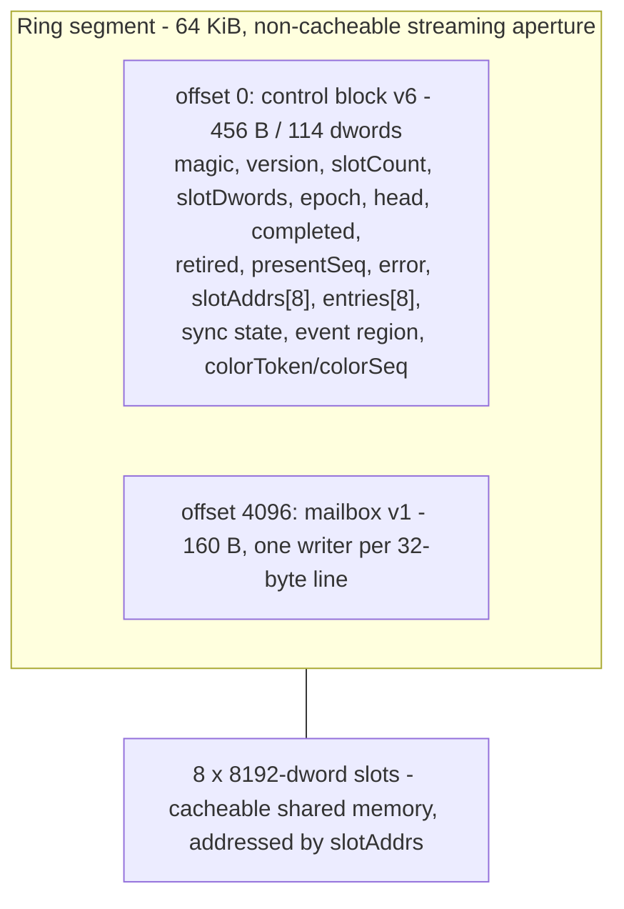
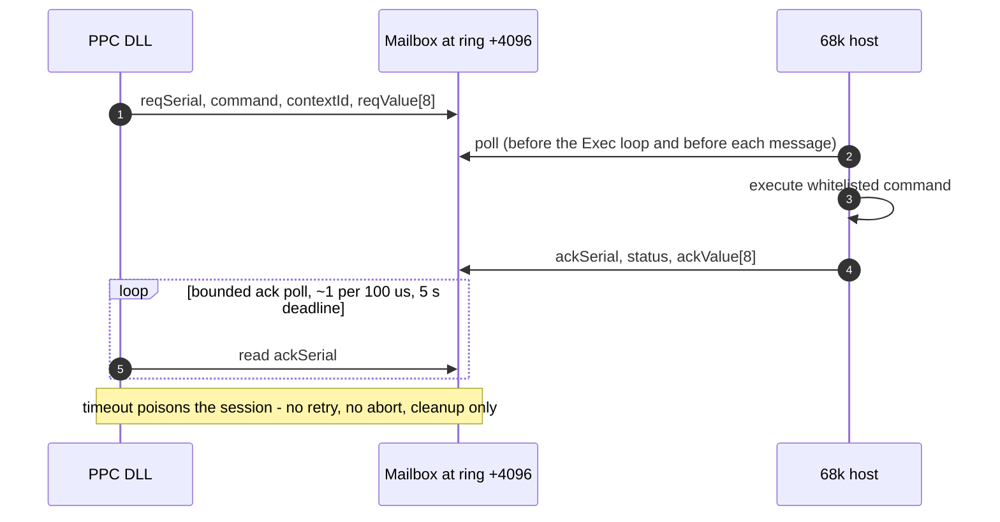

# Transport and protocol (PPC ↔ 68k)

The protocol is defined in
`backend_r200/include/libraries/minigl_ppc_protocol.h` (and mirrored in the
classic tree for the host build). Current version: **protocol 15**, ring
control **v6**, mailbox **v1**. Both CPUs are big-endian, so protocol
structures are plain `ULONG` arrays with no endian conversion. Do not add
implicit host-endian assumptions.

## 1. Channels

| Channel | Type | Used for | Cost profile |
|---|---|---|---|
| Exec `MsgPort` | request/reply messages | lifecycle: HELLO, CREATE/DESTROY, ring registration, BIND_TEXTURE, VRAM probe, chunked uploads, readback, shutdown | one `PutMsg`/`WaitPort` round trip; 1–5 ms observed per control operation |
| Ring | one-way publish + shared control block | hot draw path: semantic draw slots, present, completion/retirement feedback, events | no Exec transition; bounded by slot ownership and retirement |
| Mailbox | synchronous request/ack in shared memory | latency-sensitive queries and upload coordination: `GET_INTEGER`, `BIND_TEXTURE`, `TEXTURE_DIRECT_{BEGIN,COMMIT,ABORT,BEGIN2,COMMIT2}`, `SUBIMAGE_SHARED`, `READ_PIXELS_SHARED`, `UPLOAD_SHARED`, `CP_SURFACE` | polling in the sub-100 µs range; avoids Exec round trips entirely |

The direct upload path originally spent its time in Exec transitions (measured:
32 `glTexImage` uploads took 5.9 s wall while the host handled 137 commands in
272 ms). The mailbox exists to remove that cost, and measured
15.7 MB/s versus 0.7 MB/s for the same upload workload when it was introduced.

## 2. Message command set

`MGLPPC_CMD_*` (values as of protocol 16):

```
 1 HELLO                 2 SHUTDOWN              3 CREATE_CONTEXT
 4 CLEAR_PRESENT         5 DESTROY_CONTEXT       6 EXECUTE_BATCH
 7 GEN_TEXTURES          8 DELETE_TEXTURES       9 TEXTURE_UPLOAD_BEGIN
10 TEXTURE_UPLOAD_CHUNK 11 TEXTURE_UPLOAD_END   12 GET_INTEGER
13 VRAM_PROBE_BEGIN    14 VRAM_PROBE_CONFIRM   15 VRAM_PROBE_END
16 REGISTER_SEMANTIC_SLOTS 17 EXECUTE_SEMANTIC_SLOT 18 SEMANTIC_BARRIER
19 UNREGISTER_SEMANTIC_SLOTS 20 BIND_TEXTURE    21 REGISTER_SEMANTIC_RING
22 TEXTURE_UPLOAD_SHARED 23 TEXTURE_DIRECT_BEGIN 24 TEXTURE_DIRECT_COMMIT
25 TEXTURE_DIRECT_ABORT 26 TEXTURE_SUBIMAGE_SHARED 27 READ_PIXELS_SHARED
28 CP_SURFACE            29 TEXTURE_DIRECT_BEGIN2 30 TEXTURE_DIRECT_COMMIT2
31 LEASE_BEGIN           32 LEASE_HEARTBEAT      33 LEASE_END
```

Commands 31-33 (protocol 16) negotiate the interface-20 PPC engine lease;
see [frontend-r200.md](frontend-r200.md#101-ppc-engine-lease-opt-in-mglppc_lease1).
Over Exec, `LEASE_BEGIN` carries the context id as its one payload word; the
mailbox form has no payload.

Commands 29/30 are the opt-in **batched two-tile** direct upload
(`TEXTURE_DIRECT_BATCH_V1`, capability bit 14). They are implemented and
pixel-correct, but on the current host they are a regression on the Silent Hill
pattern (deferred pair waits ~13 ms for service versus ~0.6 ms for an immediate
single-tile begin), so the frontend default stays single-tile
(`MGLPPC_BATCH=1` enables them). See [textures.md](textures.md).

`MGLPPCMessage` layout (must match Exec's `struct Message` prefix):

```c
struct Message execMessage;   /* 20 bytes, shared with Exec */
ULONG magic;                  /* MGLPPC_MAGIC 0x4d474c50 */
ULONG protocolVersion;        /* 16 */
ULONG command;
ULONG sequence;
LONG  status;
ULONG contextId;
ULONG value[8];
ULONG payloadWords;
ULONG payload[1];             /* header is 80 bytes */
```

Static assertions check `magic` at offset 20 and `payload` at offset 80.

### Statuses

```
0 OK                 1 BAD_MESSAGE        2 BAD_VERSION     3 UNKNOWN_COMMAND
4 NO_CONTEXT         5 CONTEXT_EXISTS     6 CONTEXT_FAILED  7 GL_ERROR
8 BAD_BATCH          9 BAD_PAYLOAD       10 NO_MEMORY      11 UNSUPPORTED
12 BUSY              13 VERIFY_FAILED    14 STALE_GENERATION
```

`VERIFY_FAILED` and `STALE_GENERATION` are protocol-safety failures, not GL
errors: they indicate cache/ownership mistakes.

## 3. Capability negotiation

HELLO/registration echoes a capability mask; both sides must agree before the
optional features are used. Bit assignments:

| Bit | Name | Meaning |
|---|---|---|
| 0 | `REPLAY_V9` | legacy batch replay |
| 1 | `SEMANTIC_INLINE` | semantic slots |
| 2 | `SEMANTIC_TEXTURE_V1` | semantic texture state |
| 3 | `CRC_FIRST_ONLY` | CRC only on first chunk |
| 4 | `SEMANTIC_RING` | ring transport |
| 5 | `HOST_EVENTS` | event region |
| 6 | `TEXTURE_SHARED_V1` | shared staging uploads |
| 7 | `TEXTURE_DIRECT_V1` | direct fill |
| 8 | `MAILBOX_V1` | control mailbox |
| 9 | `TEXTURE_SUBIMAGE_V1` | shared subimage |
| 10 | `READ_PIXELS_V1` | shared readback |
| 11 | `INDIRECT` | indirect dispatch/render |
| 12 | `CP_EMIT` | PPC-built CP packets |
| 13 | `MAILBOX_UPLOAD_SHARED` | upload-shared via mailbox |
| 14 | `TEXTURE_DIRECT_BATCH_V1` | BEGIN2/COMMIT2 |
| 15 | `FENCE_DRAIN` | explicit fence drain support |
| 16 | `PPC_RING` | reserved (early v16 draft; the live bit is the ring-register reply) |
| 17 | `MAILBOX_LEASE` | `LEASE_BEGIN/HEARTBEAT/END` served through the mailbox |

The host speaks protocol 16; a BAD_VERSION HELLO downgrades the DLL to 14; ring control
v5 peers fail ring registration (v6 adds `colorToken`/`colorSeq`) and fall back.

## 4. Ring

```
segment: 64 KiB, non-cacheable streaming aperture, host-leased
offset 0:     MGLPPCRingControlV1 (32-byte aligned; 114 dwords = 456 bytes)
offset 4096:  MGLPPCMailboxV1 (160 bytes, 32-byte lines)
slots:        8 x 8192 dwords, cacheable shared memory (slotAddrs[])
```

- `MGLPPC_RING_MAGIC 0x52494e47`, `MGLPPC_RING_CONTROL_VERSION 6`,
  `MGLPPC_RING_SLOTS 8`, `MGLPPC_EVENT_SLOTS 16`.
- Each slot has a `MGLPPCRingEntryV1 { slot, dwords, generation, flags, crc }`.
- Commit entries carry `dword[0] = draw count`, `dword[1] = vertex segment pool
  index`, then header-only record chain, then one dword vertex byte offset per
  draw. State-batch entries carry one header plus `{offset, count}` descriptor
  pairs. `MGLPPC_RING_COMMIT_HEADER_DWORDS = 2`.
- Ring registration flags: `HOST_EVENTS (1<<0)`, `MAILBOX (1<<1)`,
  `INDIRECT (1<<2)`, `IB_DRY (1<<3)`, `CP_EMIT (1<<4)`.
- Control block fields: `head` (PPC advances after posting), `completed`
  (68k after consuming), `retired` (GPU fence), `presentSeq`, `error`,
  `slotAddrs[8]`, `entries[8]`, event head/tail/class/code, and the v6
  `syncEnabled`/`syncSeq` plus `colorToken`/`colorSeq` publication.
- Registration leases the ring plus `MGLPPC_VERTEX_SEGMENTS = 4` vertex
  segments and, when `CP_EMIT` is requested and echoed, 256 KiB of CP space.
  Reply tuples expand from 3 to 4 words (CPU address/bytes/id/GPU address).

Segment layout (offsets in bytes; the control block is 32-byte aligned):



### 4.1 Publication and ownership rules

1. PPC writes a slot and its entry metadata, flushes the data cache
   (`dcbf` per line + `sync`) and then advances `head`.
2. Host polls `head`, invalidates the lines (`CacheClearE`), executes, then
   advances `completed`.
3. Host publishes `retired` only when the GPU fence covering the entry has
   completed. PPC may reuse a slot/segment only after `retired` reaches it.
4. Error is sticky: the host sets `error` and stops consuming; the PPC must
   surface a GL error and re-create state as needed.
5. `presentSeq` counts completed PRESENT entries; client-side pacing uses it.

The control block lives in non-cacheable memory, so it needs no maintenance.
Slot payloads are cacheable and are explicitly flushed/invalidated — a missed
flush shows up as `VERIFY_FAILED`/`STALE_GENERATION`, not as random pixels.

## 5. Mailbox

```
MGLPPCMailboxV1 (160 bytes, at ring offset 4096):
  magic=0x4d424f58, version=1, epoch, headerPad[5]      (line 0, 32 bytes)
  reqSerial, command, contextId, reqPad[5]              (line 1, 32 bytes)
  reqValue[8]                                           (line 2, 32 bytes)
  ackSerial, status, ackPad[6]                          (line 3, 32 bytes)
  ackValue[8]                                           (line 4, 32 bytes)
```

- One outstanding request. `reqSerial`/`ackSerial` start at 1 and skip 0;
  sequence wrap is modulo 2³².
- The host polls the mailbox before its Exec loop and before each Exec message.
  The requester polls the ack with a timebase-only loop (~1 poll per 100 µs)
  and a **5 second** calibrated deadline.
- A timeout **poisons the session**: no Exec retry, no abort message, no
  fallback. The DLL performs only lifecycle/barrier cleanup; `DeleteContext`
  waits up to 5 s for reconciliation.
- Commands allowed through the mailbox are whitelisted by
  `MGLPPC_MAILBOX_COMMAND_ALLOWED()`: `CP_SURFACE`, `BIND_TEXTURE`,
  `GET_INTEGER`, `TEXTURE_DIRECT_{BEGIN,COMMIT,ABORT,BEGIN2,COMMIT2}`,
  `TEXTURE_SUBIMAGE_SHARED`, `READ_PIXELS_SHARED`, `TEXTURE_UPLOAD_SHARED`,
  and `LEASE_{BEGIN,HEARTBEAT,END}` (only with `MAILBOX_LEASE`; over Exec a
  lease handover cost 2.7-6.8 ms against a 0.15-0.4 ms host handler).
- The DLL requests the mailbox at registration only when its peer protocol
  equals `MGLPPC_PROTOCOL_VERSION`. The DLL assumed 15 through the v16 bump
  (fixed 2026-10-20), which silently turned the mailbox off and sent every
  control call over Exec.
- `MGLPPC_NOMAILBOX` disables it (diagnostic); registration echoes `MAILBOX`
  only after the region is initialized.

Request/ack handshake:



## 6. Shared-memory transfers (Exec path)

| Mechanism | Command | Limits |
|---|---|---|
| Chunked texture upload | 9/10/11 | `TEXTURE_CHUNK_WORDS = 16000` (64 KiB Exec limit), CRC-first-only optional |
| Shared staging upload | 22 | ≤ `TEXTURE_SHARED_MAX = 2 MiB`, PPC `MEMF_PUBLIC` buffer, PPC flushes, host invalidates; mailbox-gated when bit 13 is set |
| Shared subimage | 26 | tight rows, alignment 1, requires the native `SUBIMAGE_DIRECT_BGRA` capability tag |
| Shared readback | 27 | RGBA/UBYTE only, ≤ `READ_PIXELS_MAX = 2 MiB` |
| VRAM probe | 13/14/15 | 64 KiB, 64 passes, sentinels validate both read and write directions |

`IB_OFFSET = 8192` and `IB_SMOKE_DWORDS = 8`: after ring registration the
frontend publishes a small indirect-buffer smoke entry at the reserved
mailbox-adjacent region; the host validates `offset == IB_OFFSET && count == 8`
and (in dry mode) echoes `IB_DRY` without executing. This catches
indirect-dispatch wiring before real draws.

## 7. Fences, retirement and epochs

- The host owns the fence list. Each semantic submission gets a fence; a
  contiguous prefix is retired when `Radeon3DTestFence` confirms completion.
- `MGLPPC_CAP_FENCE_DRAIN` enables explicit drain requests; `MULTI_FENCE`
  (driver capability) allows more than one outstanding fence and
  `FENCE_COALESCE` groups them to cut service calls.
- `MGLPPC_FENCE_GROUP` overrides the grouping size (host runtime option).
- `ringEpoch`, `semanticEpoch` and `deviceEpoch` are monotonic. A resource
  tagged with an older epoch is rebuilt; a mismatch in a submission is
  `STALE_GENERATION`.
- Texture-use fences are kept separate from present/readback drains, so a
  texture re-upload does not wait on a display flip.

## 8. Cache and ordering contract

| Operation | PPC side (7410) | 68k side |
|---|---|---|
| Publish slot | `dcbf` each modified line of payload + `sync` before advancing `head` | — |
| Consume slot | — | `CacheClearE(..., CACRF_ClearD)` before Execute |
| Publish control fields | non-cacheable region: plain store | — |
| Publish host→PPC data | `dcbf` + `sync`, then sequence store | `CacheClearE` after invalidate |
| AltiVec stores | scalar staging to 16-byte scratch, `stvx` to aperture, `sync` | — |

Helper routines: `MGLPPCFlushDataRange`, `MGLPPCStoreBarrier`,
`MGLPPCInvalidateLine32` (`backend_r200/client/minigl_warpos_cache_flush.s`),
`MGLPPCYield` (`minigl_ppc_yield.c`).

The color-target publication is the one place with a documented read order:
host writes `colorToken` first and `colorSeq` last, then flushes; PPC reads
`colorSeq` first. Keep that order.

## 9. Yield / back-pressure rules

- Poll a bounded budget (`131072` iterations observed in the fixed design)
  before yielding; never `Delay(1)` in a hot back-pressure loop. On this kernel
  `Delay(1)` quantizes to 50 Hz and `WaitTime(0, 100)` measured ~20.3 ms per
  call; the pre-fix code spent 198 such calls per 600 frames and lost ~35% of
  throughput.
- Measure the actual elapsed ticks, not the requested timeout.
- Timeouts are session-fatal for mailbox operations by design; do not add
  retries.

## 10. Versioning and compatibility

- Protocol 16 is the current wire version (adds the lease commands); the DLL
  downgrades to 14 on a BAD_VERSION HELLO.
- Ring control 6 is current; v5 peers fall back rather than run with a
  mismatched control block.
- Never change field offsets or add fields to `MGLPPCRingControlV1` —
  it has static offset/size checks and both peers must agree exactly.
- Protocol copies exist in the classic tree
  (`classic_68k/dev/.../include/libraries/minigl_ppc_protocol.h`); a drift
  assertion in `tests/test_r200_context_lifecycle.py` guards them. Keep all
  copies byte-identical.

## Related documents

- [reference/MAILBOX_V1.md](reference/MAILBOX_V1.md) — original mailbox spec.
- [reference/CP_EMITTER.md](reference/CP_EMITTER.md) — CP-emitter extension.
- [host-68k.md](host-68k.md) — how the host implements its side.
